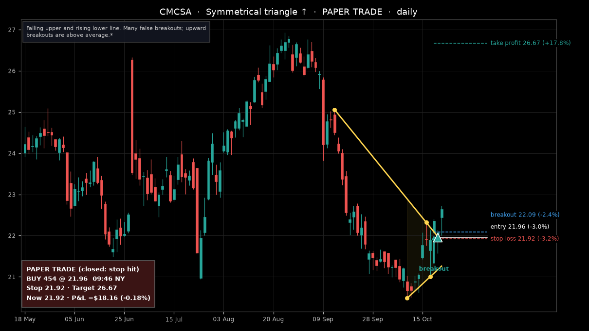
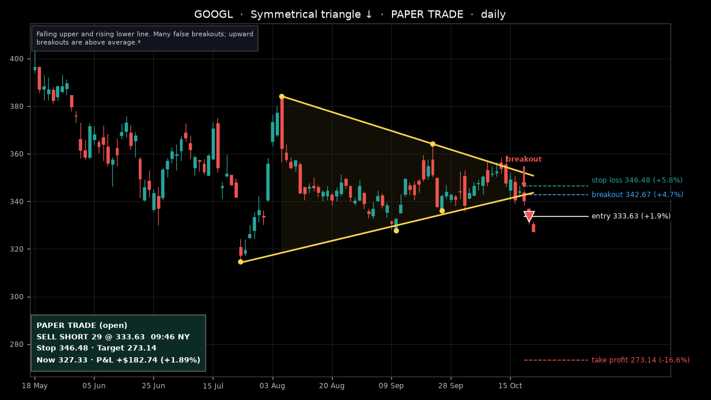
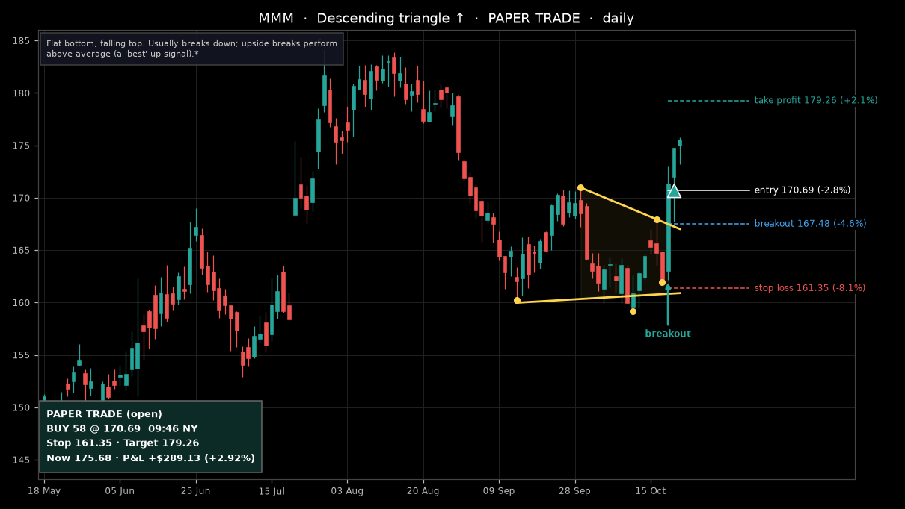
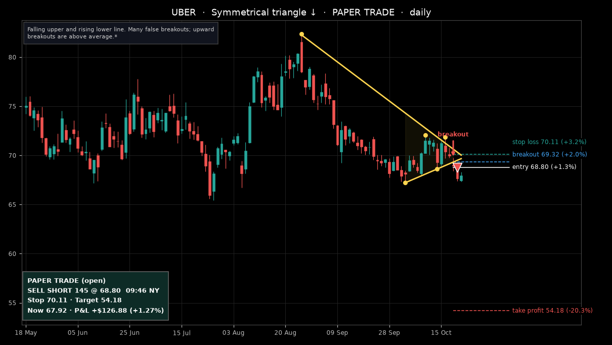
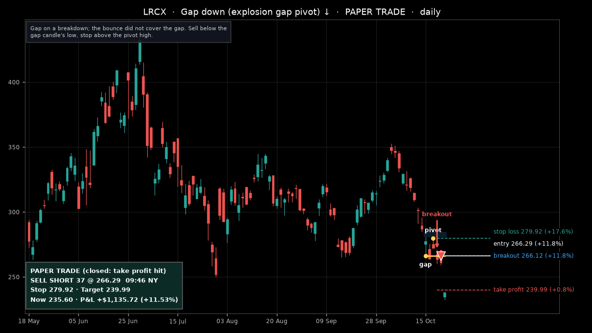

# Deck pattern trader: trades opened on 2026-10-21

Pattern Alpaca paper account, orders tagged `pat-deck_…`. Prices as of 22 Oct 09:53 New York (Alpaca data, about 16 minutes delayed for the chart candles).

**5 trades · open P&L +$1,716.31**

| # | Stock | Pattern | Side | Qty | Entry | Stop | Take profit | Now | P&L | Status |
|---|---|---|---|---|---|---|---|---|---|---|
| 1 | CMCSA | Symmetrical triangle up | LONG | 454 | 21.96 | 21.92 | 26.67 | 21.92 | −$18.16 (-0.18%) | closed: stop hit |
| 2 | GOOGL | Symmetrical triangle down | SHORT | 29 | 333.63 | 346.48 | 273.14 | 327.33 | +$182.74 (+1.89%) | open |
| 3 | MMM | Descending triangle up | LONG | 58 | 170.69 | 161.35 | 179.26 | 175.68 | +$289.13 (+2.92%) | open |
| 4 | UBER | Symmetrical triangle down | SHORT | 145 | 68.80 | 70.11 | 54.18 | 67.92 | +$126.88 (+1.27%) | open |
| 5 | LRCX | Gap down down | SHORT | 37 | 266.29 | 279.92 | 239.99 | 235.60 | +$1,135.72 (+11.53%) | closed: take profit hit |

### 1. CMCSA — Symmetrical triangle up (closed: stop hit)

### 2. GOOGL — Symmetrical triangle down (open)

### 3. MMM — Descending triangle up (open)

### 4. UBER — Symmetrical triangle down (open)

### 5. LRCX — Gap down down (closed: take profit hit)

