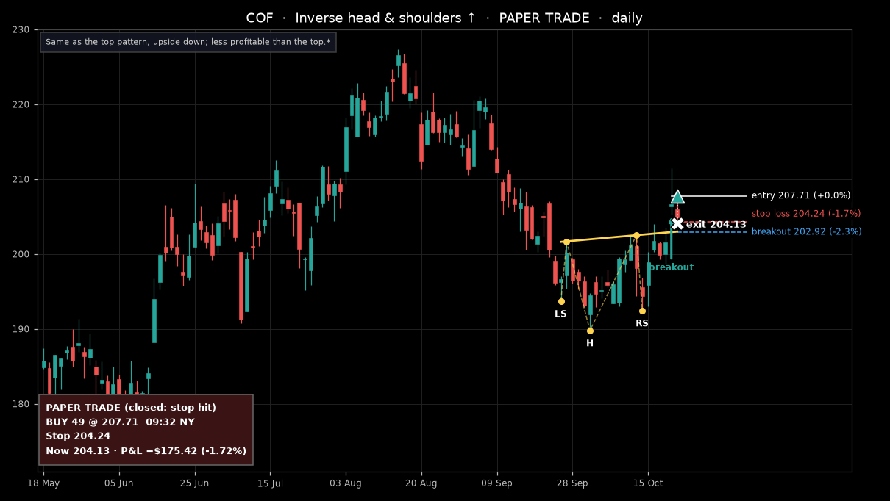
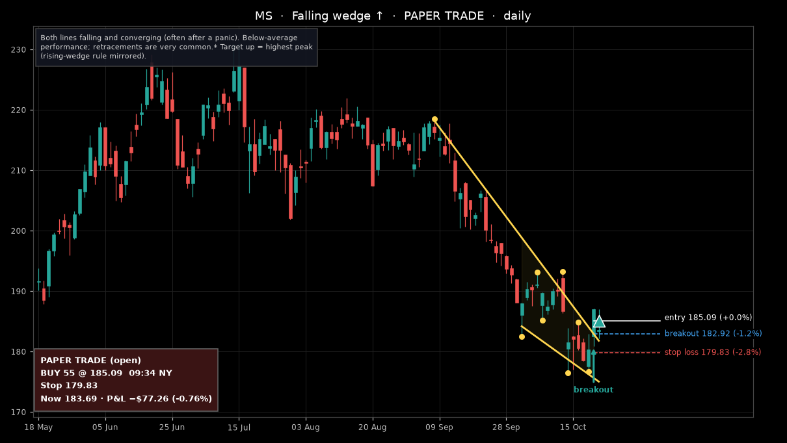

# Deck pattern trader: trades opened on 2026-10-22

Pattern Alpaca paper account, orders tagged `pat-deck_…`. Prices as of 22 Oct 12:07 New York (Alpaca data, about 16 minutes delayed for the chart candles).

**2 trades · open P&L −$252.68**

| # | Stock | Pattern | Side | Qty | Entry | Stop | Take profit | Now | P&L | Status |
|---|---|---|---|---|---|---|---|---|---|---|
| 1 | COF | Inverse head shoulders up | LONG | 49 | 207.71 | 204.24 | – | 204.13 | −$175.42 (-1.72%) | closed: stop hit |
| 2 | MS | Falling wedge up | LONG | 55 | 185.09 | 179.83 | – | 183.69 | −$77.26 (-0.76%) | open |

### 1. COF — Inverse head shoulders up (closed: stop hit)

### 2. MS — Falling wedge up (open)

