# Pattern scan preview 2026-10-21 (daily)

```
🧩 Pattern scan — S&P 100, daily candles, 21 Oct 13:20 NY
23 breakouts, 57 forming · 34 charts sent

New
🟡 JPM Descending triangle (↑341.86 / ↓327.35, now 335.26)
🟡 LLY Double bottom (↑1292.65, now 1283.66)
🟡 MDLZ Double bottom (↑66.07, now 63.99)
🟡 MDT Triple top (↓85.22, now 94.63)
🟡 MO Head &amp; shoulders top (↓60.12, now 74.64)
🟡 MS Falling wedge (↑184.06 / ↓175.18, now 180.40)
🟡 MU Head &amp; shoulders top (↓539.33, now 896.07)
🟡 NFLX Double top (↓66.54, now 68.69)
🟡 NOW Cup and handle (↑154.20, now 149.54)
🟡 TMO Triple top (↓635.32, now 687.37)
🟡 WMT Cup and handle (↑122.65, now 117.85)
🟡 ABBV Bull flag (↑291.41, now 289.08)
🟡 AMD Bear pennant (↓524.60, now 534.74)
🟡 ANET Bear pennant (↓176.54, now 181.19)
🟡 ANET Gap down (explosion gap pivot) (↓178.47, now 181.19)
🟡 BAC Gap down (explosion gap pivot) (↓49.26, now 50.64)
🟡 CAT Bear flag (↓705.20, now 725.24)
🟡 COST Bull pennant (↑1004.81, now 994.61)
🟡 DELL Gap down (explosion gap pivot) (↓451.79, now 461.56)
🟡 INTC Bear flag (↓88.77, now 91.69)
🟡 INTU Pipe top (↓320.86, now 335.29)
🟡 KO Bull pennant (↑94.00, now 93.49)
🟡 MDLZ Bull pennant (↑64.47, now 63.99)
🟡 MDT Bull flag (↑95.37, now 94.63)
🟡 MO Bull flag (↑75.52, now 74.64)
🟡 MS Gap down (explosion gap pivot) (↓176.44, now 180.40)
🟡 MU Bear pennant (↓881.52, now 896.07)
🟡 NVDA Bear flag (↓212.77, now 216.47)
🟡 PG Bull pennant (↑159.47, now 159.32)
🟡 SNDK Bear pennant (↓1330.00, now 1365.38)
🟡 T Gap down (explosion gap pivot) (↓21.96, now 23.42)
🟡 TMUS Gap down (explosion gap pivot) (↓147.90, now 157.75)
🟡 WMT Bull flag (↑120.53, now 117.85)
🟡 WMT Gap up (explosion gap pivot) (↑121.38, now 117.85)

Still there (already sent)
🔴 AVGO Triple top ↓ @ 335.20 → 294.49
🟢 BA Descending triangle ↑ @ 186.74 → 207.42
🟢 CMCSA Symmetrical triangle ↑ @ 22.09 → 26.67
🔴 GOOGL Symmetrical triangle ↓ @ 342.67 → 273.14
🟢 LIN Cup and handle ↑ @ 492.88 → 530.79
🔴 LRCX Rectangle ↓ @ 275.45 → 196.02
🔴 META Double top ↓ @ 711.68 → 643.55
🟢 MMM Descending triangle ↑ @ 167.48 → 179.26
🔴 ORCL Descending triangle ↓ @ 130.79 → 108.86 ⚠️
🔴 TSLA Ascending triangle ↓ @ 359.11 → 267.93 ⚠️
🔴 UBER Symmetrical triangle ↓ @ 69.32 → 54.18
🟢 USB Descending triangle ↑ @ 57.06 → 61.62
🟢 WFC Descending triangle ↑ @ 83.21 → 97.20 ⚠️
🟢 ACN Gap up (explosion gap pivot) ↑ @ 226.27
🟢 AMT Gap up (explosion gap pivot) ↑ @ 182.52
🟢 LLY Gap up (explosion gap pivot) ↑ @ 1275.88
🔴 LRCX Gap down (explosion gap pivot) ↓ @ 266.12
🔴 AMGN Shooting star ↓ @ 433.42
🟢 BNY Hammer ↑ @ 142.63
🟢 C Hammer ↑ @ 123.45
🔴 GE Shooting star ↓ @ 313.20
🔴 GILD Shooting star ↓ @ 156.02
🟢 V Doji ↑ @ 404.74
🟡 AAPL Triple top (↓325.81, now 339.50)
🟡 ADBE Rising wedge (↑258.00 / ↓240.93, now 256.73)
🟡 AMGN Cup and handle (↑445.81, now 438.94)
🟡 AMZN Rectangle (↑265.38 / ↓249.15, now 262.63)
🟡 BKNG Rectangle (↑169.02 / ↓152.27, now 163.92)
🟡 BLK Double bottom (↑1181.11, now 1128.68)
🟡 BMY Double top (↓56.15, now 61.68)
🟡 COF Inverse head &amp; shoulders (↑202.85, now 201.56)
🟡 CSCO Triple bottom (↑124.23, now 106.71)
🟡 DE Falling wedge (↑651.86 / ↓606.41, now 632.20)
🟡 DHR Triple top (↓211.18, now 224.24)
🟡 DIS Cup and handle (↑112.69, now 111.67)
🟡 EMR Cup and handle (↑165.79, now 160.46)
🟡 GEV Head &amp; shoulders top (↓871.53, now 890.33)
🟡 GEV Triple bottom (↑1195.94, now 890.33)
🟡 GM Head &amp; shoulders top (↓76.93, now 77.09)
🟡 GS Falling wedge (↑909.49 / ↓854.28, now 884.81)
🟡 INTU Symmetrical triangle (↑341.61 / ↓263.58, now 335.29)
🟡 AMAT Doji (↑412.46 / ↓399.02, now 404.98)
🟡 COP Hanging man (↑147.15 / ↓142.80, now 145.95)
🟡 GM Doji (↑78.97 / ↓75.08, now 77.09)
🟡 NVDA Doji (↑218.46 / ↓212.77, now 216.47)
🟡 RTX Doji (↑197.00 / ↓188.08, now 193.34)

✅ scan done in 6s
```

### 01-JPM-Descending_triangle-forming.png

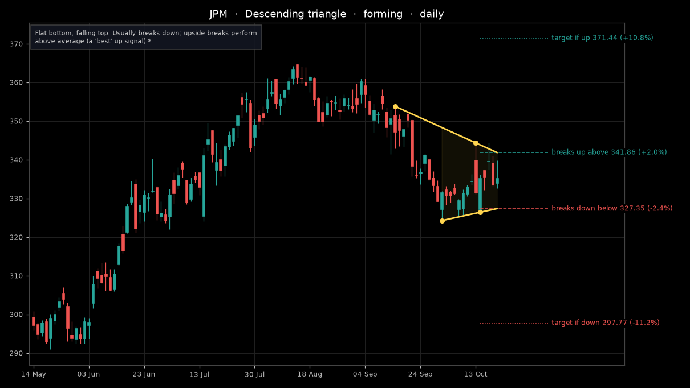

🟡 <b>JPM</b> — Descending triangle forming (daily)
Price now 335.26
↑ completes on a close above 341.86 (+2.0%) → target 371.44
↓ completes on a close below 327.35 (-2.4%) → target 297.77
📖 Flat bottom, falling top. Usually breaks down; upside breaks perform above average (a &#x27;best&#x27; up signal).*
<a href="https://www.tradingview.com/chart/?symbol=JPM">TradingView</a>

### 02-LLY-Double_bottom-forming.png

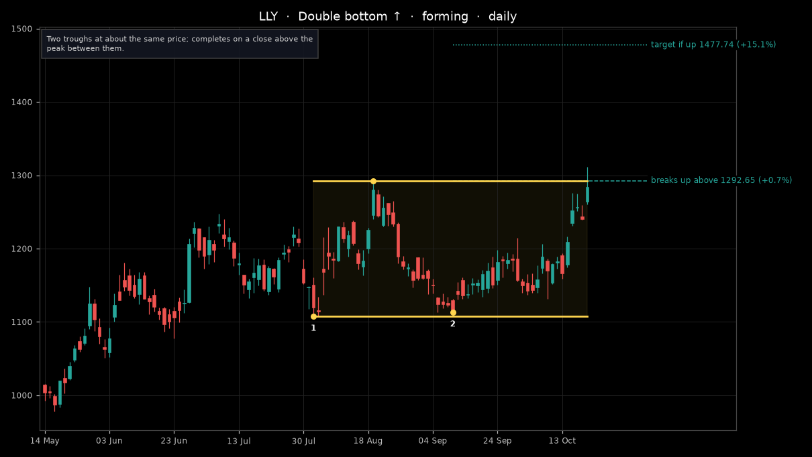

🟡 <b>LLY</b> — Double bottom ↑ forming (daily)
Price now 1283.66
↑ completes on a close above 1292.65 (+0.7%) → target 1477.74
📖 Two troughs at about the same price; completes on a close above the peak between them.
<a href="https://www.tradingview.com/chart/?symbol=LLY">TradingView</a>

### 03-MDLZ-Double_bottom-forming.png

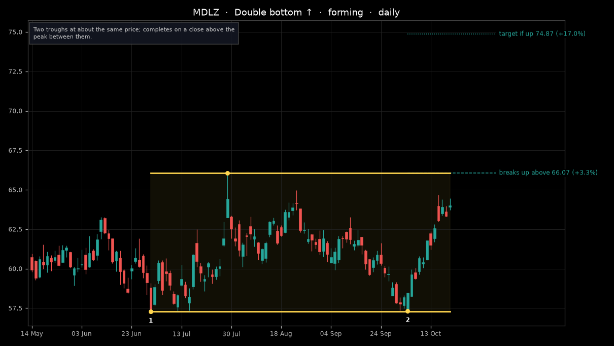

🟡 <b>MDLZ</b> — Double bottom ↑ forming (daily)
Price now 63.99
↑ completes on a close above 66.07 (+3.3%) → target 74.87
📖 Two troughs at about the same price; completes on a close above the peak between them.
<a href="https://www.tradingview.com/chart/?symbol=MDLZ">TradingView</a>

### 04-MDT-Triple_top-forming.png

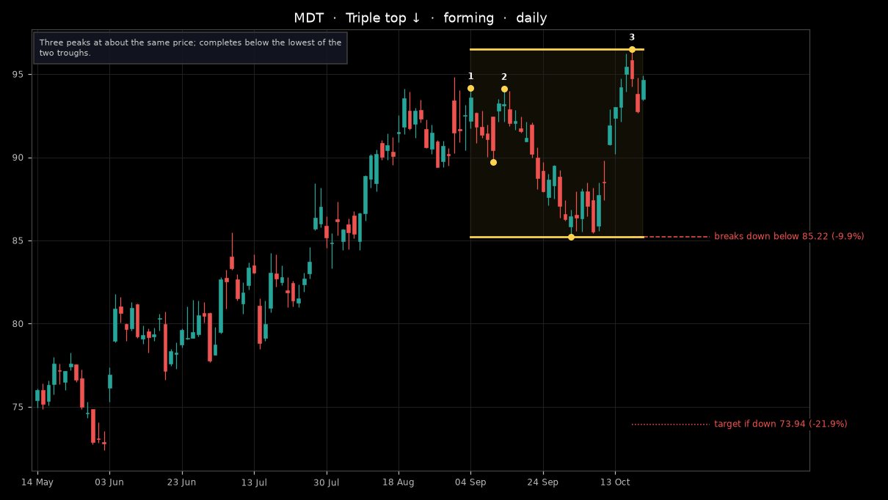

🟡 <b>MDT</b> — Triple top ↓ forming (daily)
Price now 94.63
↓ completes on a close below 85.22 (-9.9%) → target 73.94
📖 Three peaks at about the same price; completes below the lowest of the two troughs.
<a href="https://www.tradingview.com/chart/?symbol=MDT">TradingView</a>

### 05-MO-Head_and_shoulders_top-forming.png

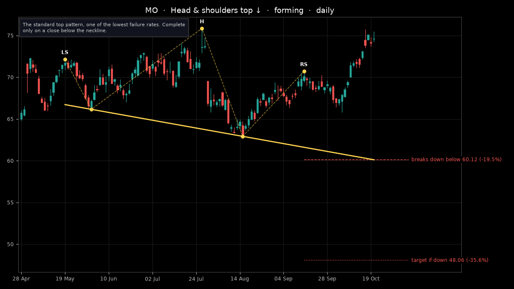

🟡 <b>MO</b> — Head &amp; shoulders top ↓ forming (daily)
Price now 74.64
↓ completes on a close below 60.12 (-19.5%) → target 48.06
📖 The standard top pattern, one of the lowest failure rates. Complete only on a close below the neckline.
<a href="https://www.tradingview.com/chart/?symbol=MO">TradingView</a>

### 06-MS-Falling_wedge-forming.png

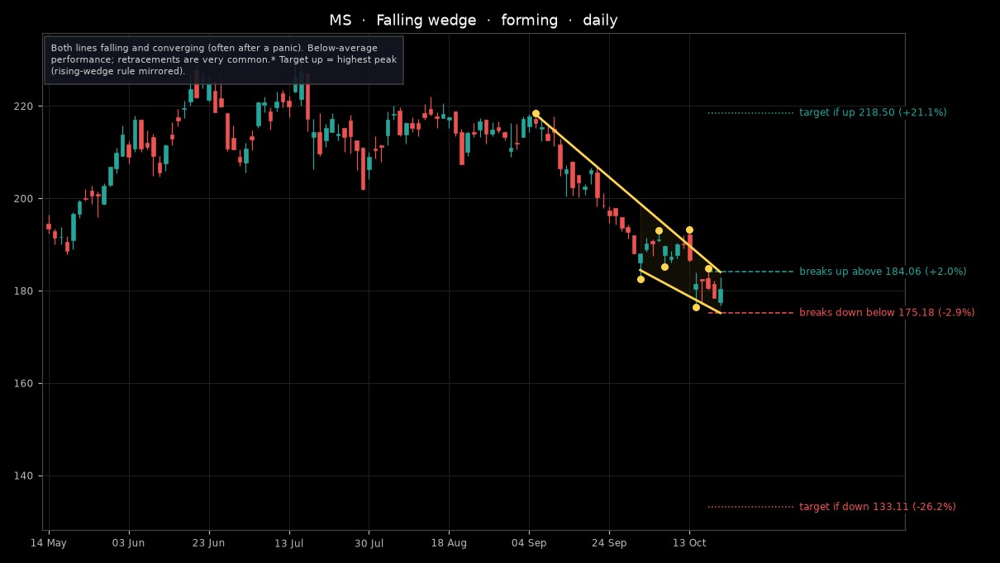

🟡 <b>MS</b> — Falling wedge forming (daily)
Price now 180.40
↑ completes on a close above 184.06 (+2.0%) → target 218.50
↓ completes on a close below 175.18 (-2.9%) → target 133.11
📖 Both lines falling and converging (often after a panic). Below-average performance; retracements are very common.* Target up = highest peak (rising-wedge rule mirrored).
<a href="https://www.tradingview.com/chart/?symbol=MS">TradingView</a>

### 07-MU-Head_and_shoulders_top-forming.png

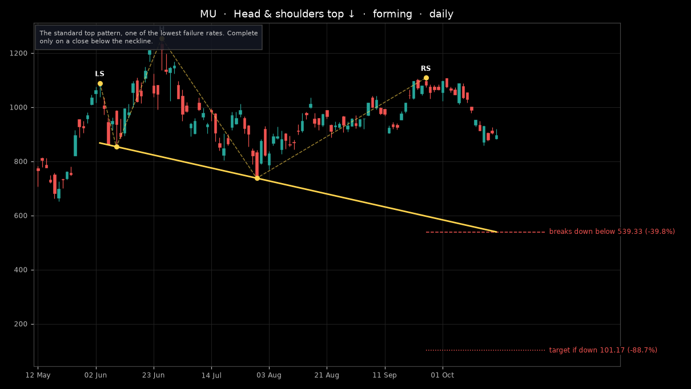

🟡 <b>MU</b> — Head &amp; shoulders top ↓ forming (daily)
Price now 896.07
↓ completes on a close below 539.33 (-39.8%) → target 101.17
📖 The standard top pattern, one of the lowest failure rates. Complete only on a close below the neckline.
<a href="https://www.tradingview.com/chart/?symbol=MU">TradingView</a>

### 08-NFLX-Double_top-forming.png

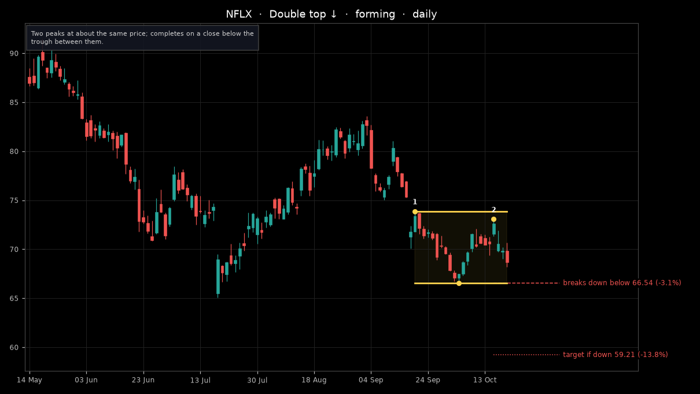

🟡 <b>NFLX</b> — Double top ↓ forming (daily)
Price now 68.69
↓ completes on a close below 66.54 (-3.1%) → target 59.21
📖 Two peaks at about the same price; completes on a close below the trough between them.
<a href="https://www.tradingview.com/chart/?symbol=NFLX">TradingView</a>

### 09-NOW-Cup_and_handle-forming.png

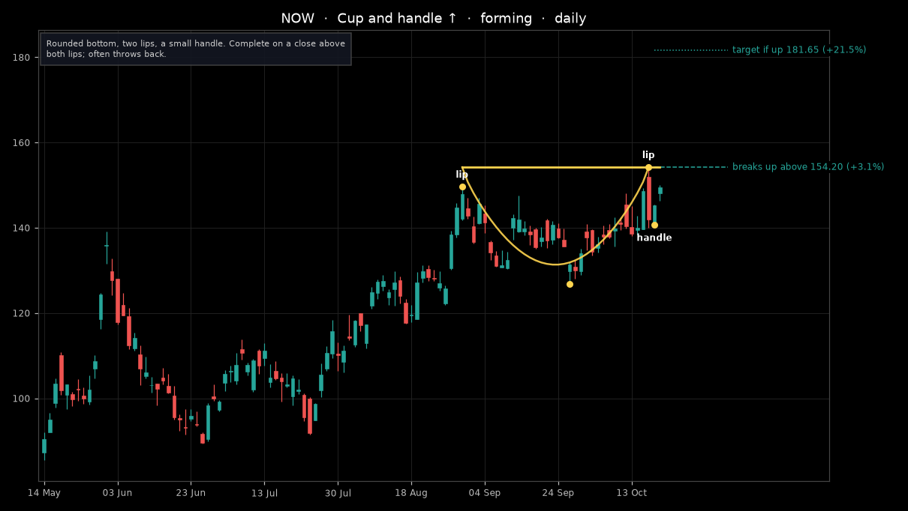

🟡 <b>NOW</b> — Cup and handle ↑ forming (daily)
Price now 149.54
↑ completes on a close above 154.20 (+3.1%) → target 181.65
📖 Rounded bottom, two lips, a small handle. Complete on a close above both lips; often throws back.
<a href="https://www.tradingview.com/chart/?symbol=NOW">TradingView</a>

### 10-TMO-Triple_top-forming.png

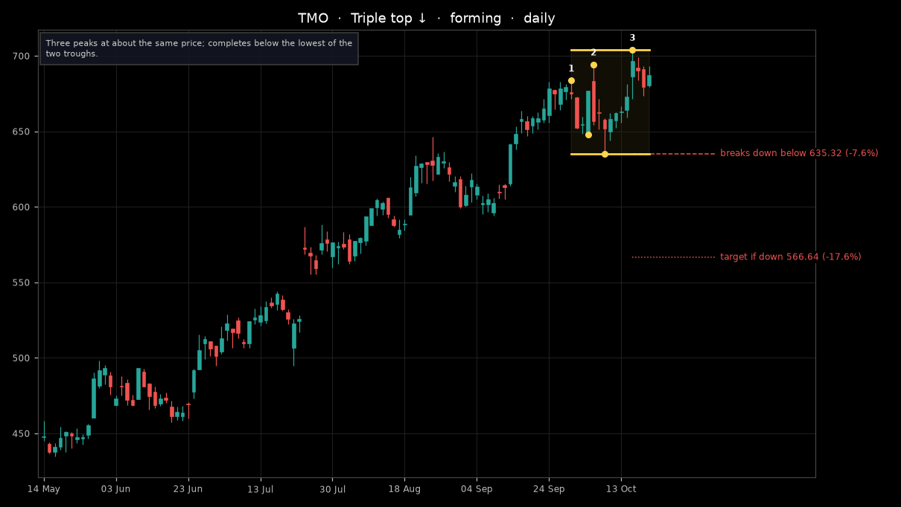

🟡 <b>TMO</b> — Triple top ↓ forming (daily)
Price now 687.37
↓ completes on a close below 635.32 (-7.6%) → target 566.64
📖 Three peaks at about the same price; completes below the lowest of the two troughs.
<a href="https://www.tradingview.com/chart/?symbol=TMO">TradingView</a>

### 11-WMT-Cup_and_handle-forming.png

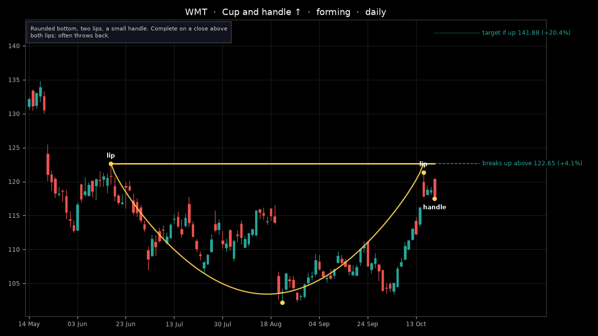

🟡 <b>WMT</b> — Cup and handle ↑ forming (daily)
Price now 117.85
↑ completes on a close above 122.65 (+4.1%) → target 141.88
📖 Rounded bottom, two lips, a small handle. Complete on a close above both lips; often throws back.
<a href="https://www.tradingview.com/chart/?symbol=WMT">TradingView</a>

### 12-ABBV-Bull_flag-forming.png

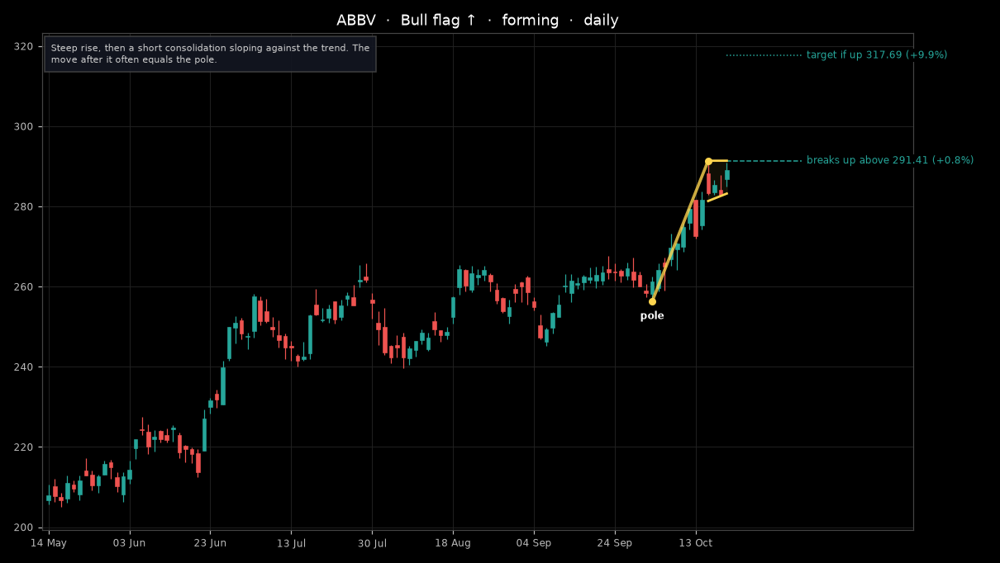

🟡 <b>ABBV</b> — Bull flag ↑ forming (daily)
Price now 289.08
↑ completes on a close above 291.41 (+0.8%) → target 317.69
📖 Steep rise, then a short consolidation sloping against the trend. The move after it often equals the pole.
<a href="https://www.tradingview.com/chart/?symbol=ABBV">TradingView</a>

### 13-AMD-Bear_pennant-forming.png

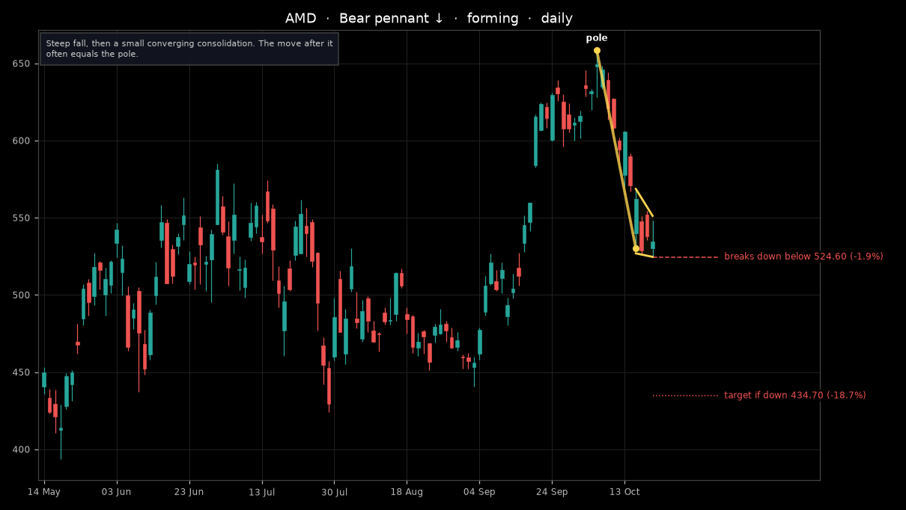

🟡 <b>AMD</b> — Bear pennant ↓ forming (daily)
Price now 534.74
↓ completes on a close below 524.60 (-1.9%) → target 434.70
📖 Steep fall, then a small converging consolidation. The move after it often equals the pole.
<a href="https://www.tradingview.com/chart/?symbol=AMD">TradingView</a>

### 14-ANET-Bear_pennant-forming.png

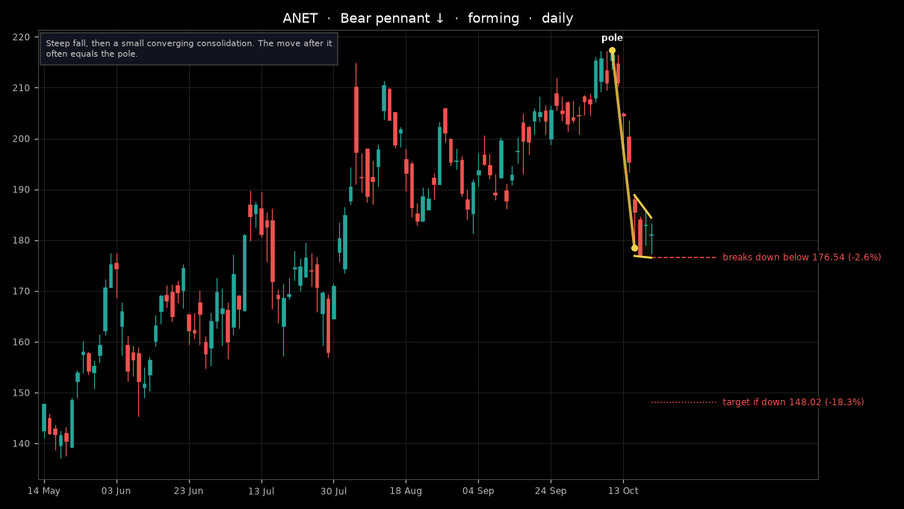

🟡 <b>ANET</b> — Bear pennant ↓ forming (daily)
Price now 181.19
↓ completes on a close below 176.54 (-2.6%) → target 148.02
📖 Steep fall, then a small converging consolidation. The move after it often equals the pole.
<a href="https://www.tradingview.com/chart/?symbol=ANET">TradingView</a>

### 15-ANET-Gap_down-forming.png

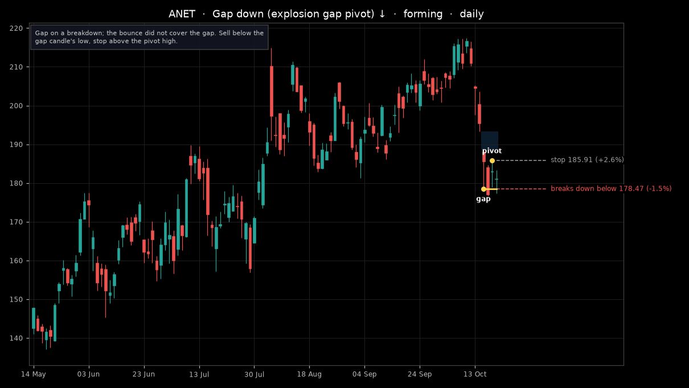

🟡 <b>ANET</b> — Gap down (explosion gap pivot) ↓ forming (daily)
Price now 181.19
↓ completes on a close below 178.47 (-1.5%)
📖 Gap on a breakdown; the bounce did not cover the gap. Sell below the gap candle&#x27;s low, stop above the pivot high.
<a href="https://www.tradingview.com/chart/?symbol=ANET">TradingView</a>

### 16-BAC-Gap_down-forming.png

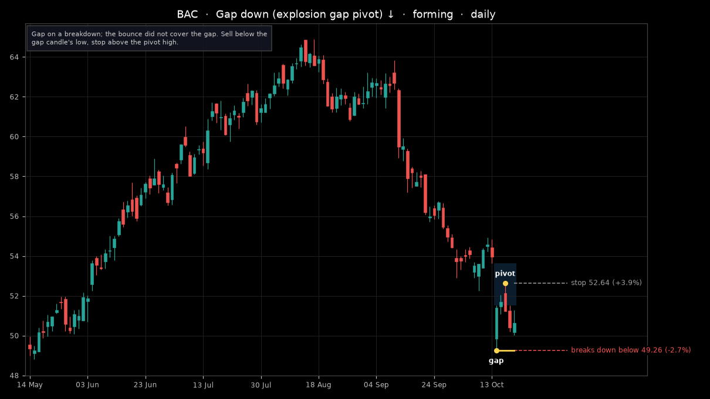

🟡 <b>BAC</b> — Gap down (explosion gap pivot) ↓ forming (daily)
Price now 50.64
↓ completes on a close below 49.26 (-2.7%)
📖 Gap on a breakdown; the bounce did not cover the gap. Sell below the gap candle&#x27;s low, stop above the pivot high.
<a href="https://www.tradingview.com/chart/?symbol=BAC">TradingView</a>

### 17-CAT-Bear_flag-forming.png

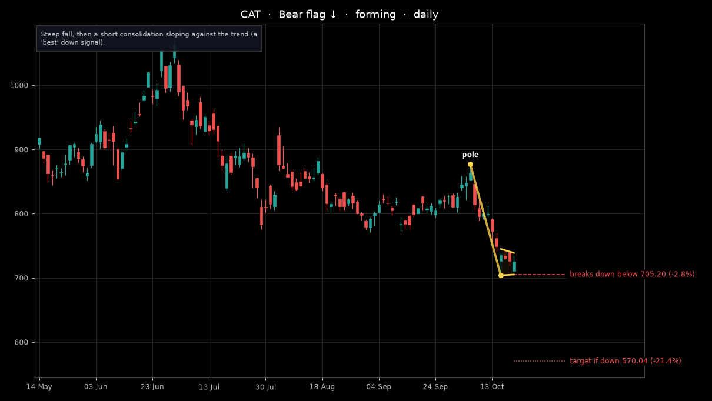

🟡 <b>CAT</b> — Bear flag ↓ forming (daily)
Price now 725.24
↓ completes on a close below 705.20 (-2.8%) → target 570.04
📖 Steep fall, then a short consolidation sloping against the trend (a &#x27;best&#x27; down signal).
<a href="https://www.tradingview.com/chart/?symbol=CAT">TradingView</a>

### 18-COST-Bull_pennant-forming.png

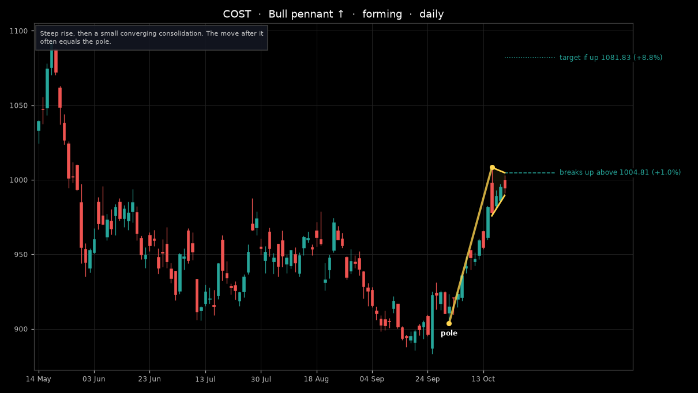

🟡 <b>COST</b> — Bull pennant ↑ forming (daily)
Price now 994.61
↑ completes on a close above 1004.81 (+1.0%) → target 1081.83
📖 Steep rise, then a small converging consolidation. The move after it often equals the pole.
<a href="https://www.tradingview.com/chart/?symbol=COST">TradingView</a>

### 19-DELL-Gap_down-forming.png

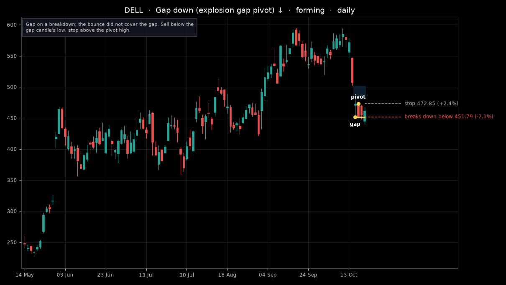

🟡 <b>DELL</b> — Gap down (explosion gap pivot) ↓ forming (daily)
Price now 461.56
↓ completes on a close below 451.79 (-2.1%)
📖 Gap on a breakdown; the bounce did not cover the gap. Sell below the gap candle&#x27;s low, stop above the pivot high.
<a href="https://www.tradingview.com/chart/?symbol=DELL">TradingView</a>

### 20-INTC-Bear_flag-forming.png

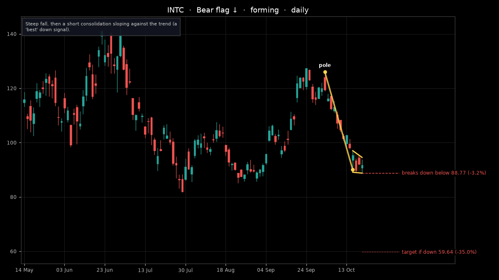

🟡 <b>INTC</b> — Bear flag ↓ forming (daily)
Price now 91.69
↓ completes on a close below 88.77 (-3.2%) → target 59.64
📖 Steep fall, then a short consolidation sloping against the trend (a &#x27;best&#x27; down signal).
<a href="https://www.tradingview.com/chart/?symbol=INTC">TradingView</a>

### 21-INTU-Pipe_top-forming.png

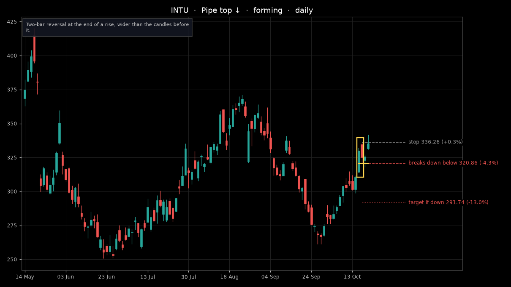

🟡 <b>INTU</b> — Pipe top ↓ forming (daily)
Price now 335.29
↓ completes on a close below 320.86 (-4.3%) → target 291.74
📖 Two-bar reversal at the end of a rise, wider than the candles before it.
<a href="https://www.tradingview.com/chart/?symbol=INTU">TradingView</a>

### 22-KO-Bull_pennant-forming.png

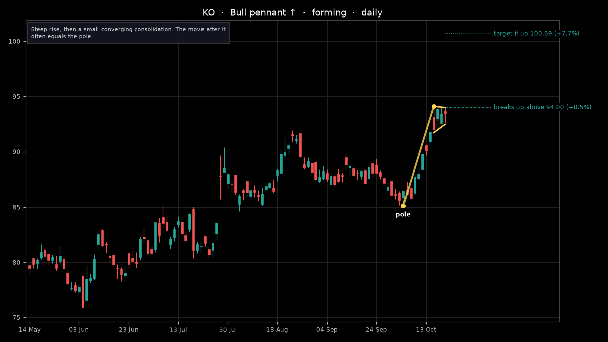

🟡 <b>KO</b> — Bull pennant ↑ forming (daily)
Price now 93.49
↑ completes on a close above 94.00 (+0.5%) → target 100.69
📖 Steep rise, then a small converging consolidation. The move after it often equals the pole.
<a href="https://www.tradingview.com/chart/?symbol=KO">TradingView</a>

### 23-MDLZ-Bull_pennant-forming.png

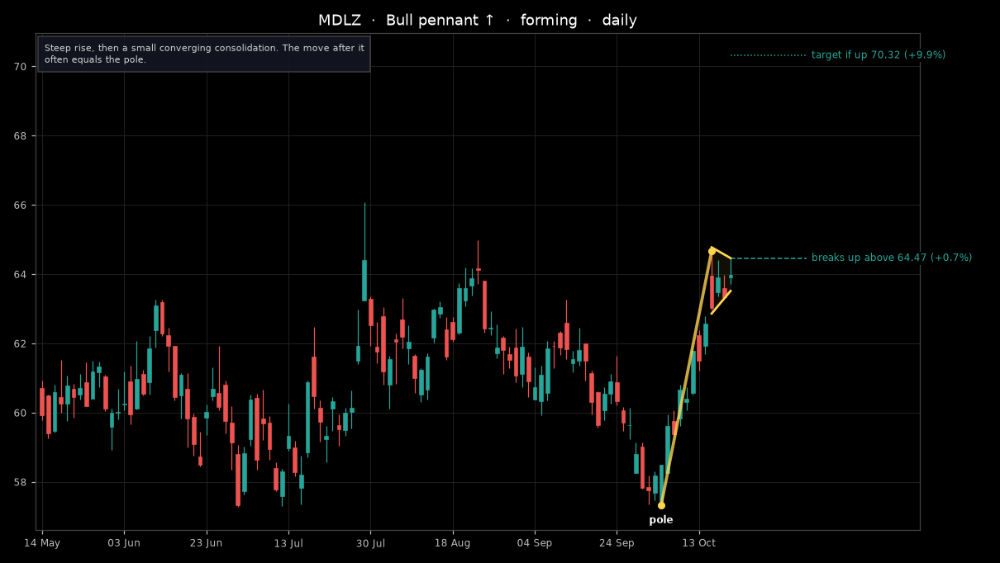

🟡 <b>MDLZ</b> — Bull pennant ↑ forming (daily)
Price now 63.99
↑ completes on a close above 64.47 (+0.7%) → target 70.32
📖 Steep rise, then a small converging consolidation. The move after it often equals the pole.
<a href="https://www.tradingview.com/chart/?symbol=MDLZ">TradingView</a>

### 24-MDT-Bull_flag-forming.png

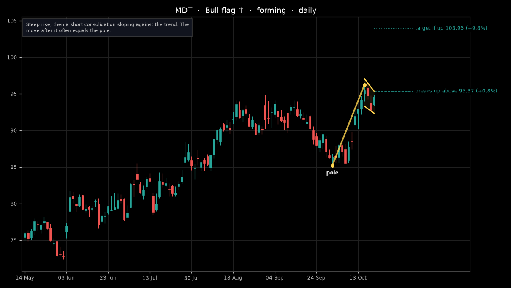

🟡 <b>MDT</b> — Bull flag ↑ forming (daily)
Price now 94.63
↑ completes on a close above 95.37 (+0.8%) → target 103.95
📖 Steep rise, then a short consolidation sloping against the trend. The move after it often equals the pole.
<a href="https://www.tradingview.com/chart/?symbol=MDT">TradingView</a>

### 25-MO-Bull_flag-forming.png

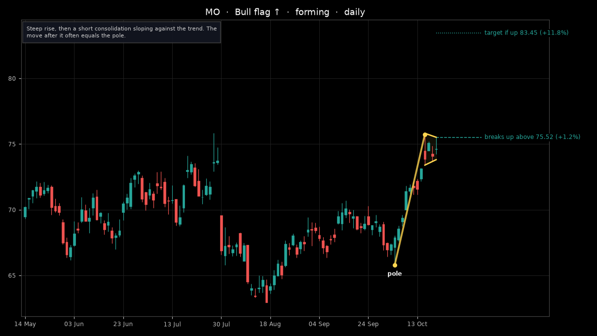

🟡 <b>MO</b> — Bull flag ↑ forming (daily)
Price now 74.64
↑ completes on a close above 75.52 (+1.2%) → target 83.45
📖 Steep rise, then a short consolidation sloping against the trend. The move after it often equals the pole.
<a href="https://www.tradingview.com/chart/?symbol=MO">TradingView</a>

### 26-MS-Gap_down-forming.png

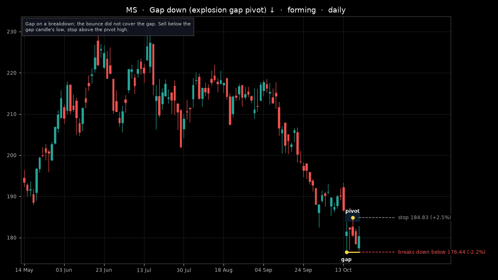

🟡 <b>MS</b> — Gap down (explosion gap pivot) ↓ forming (daily)
Price now 180.40
↓ completes on a close below 176.44 (-2.2%)
📖 Gap on a breakdown; the bounce did not cover the gap. Sell below the gap candle&#x27;s low, stop above the pivot high.
<a href="https://www.tradingview.com/chart/?symbol=MS">TradingView</a>

### 27-MU-Bear_pennant-forming.png

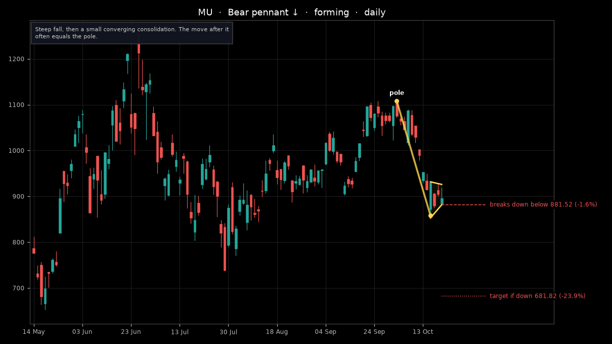

🟡 <b>MU</b> — Bear pennant ↓ forming (daily)
Price now 896.07
↓ completes on a close below 881.52 (-1.6%) → target 681.82
📖 Steep fall, then a small converging consolidation. The move after it often equals the pole.
<a href="https://www.tradingview.com/chart/?symbol=MU">TradingView</a>

### 28-NVDA-Bear_flag-forming.png

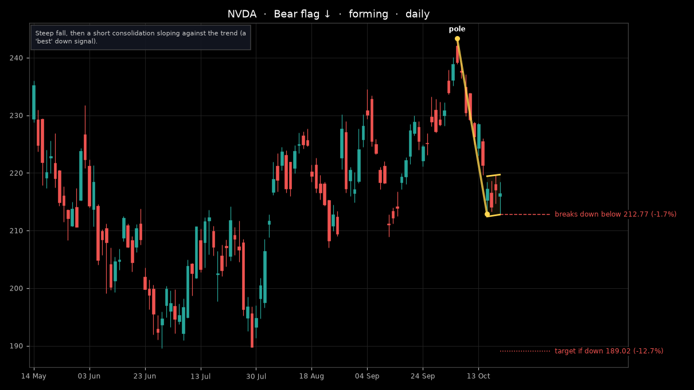

🟡 <b>NVDA</b> — Bear flag ↓ forming (daily)
Price now 216.47
↓ completes on a close below 212.77 (-1.7%) → target 189.02
📖 Steep fall, then a short consolidation sloping against the trend (a &#x27;best&#x27; down signal).
<a href="https://www.tradingview.com/chart/?symbol=NVDA">TradingView</a>

### 29-PG-Bull_pennant-forming.png

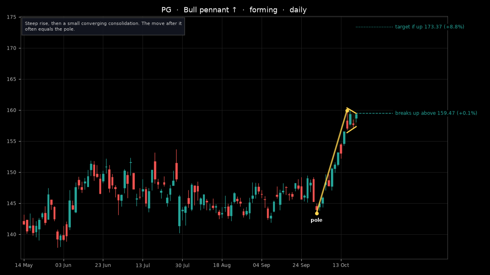

🟡 <b>PG</b> — Bull pennant ↑ forming (daily)
Price now 159.32
↑ completes on a close above 159.47 (+0.1%) → target 173.37
📖 Steep rise, then a small converging consolidation. The move after it often equals the pole.
<a href="https://www.tradingview.com/chart/?symbol=PG">TradingView</a>

### 30-SNDK-Bear_pennant-forming.png

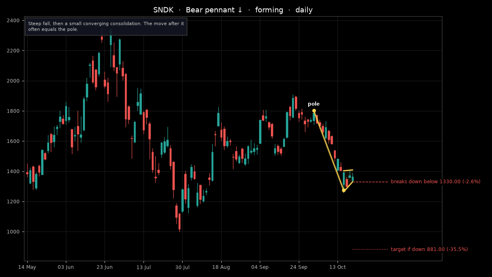

🟡 <b>SNDK</b> — Bear pennant ↓ forming (daily)
Price now 1365.38
↓ completes on a close below 1330.00 (-2.6%) → target 881.00
📖 Steep fall, then a small converging consolidation. The move after it often equals the pole.
<a href="https://www.tradingview.com/chart/?symbol=SNDK">TradingView</a>

### 31-T-Gap_down-forming.png

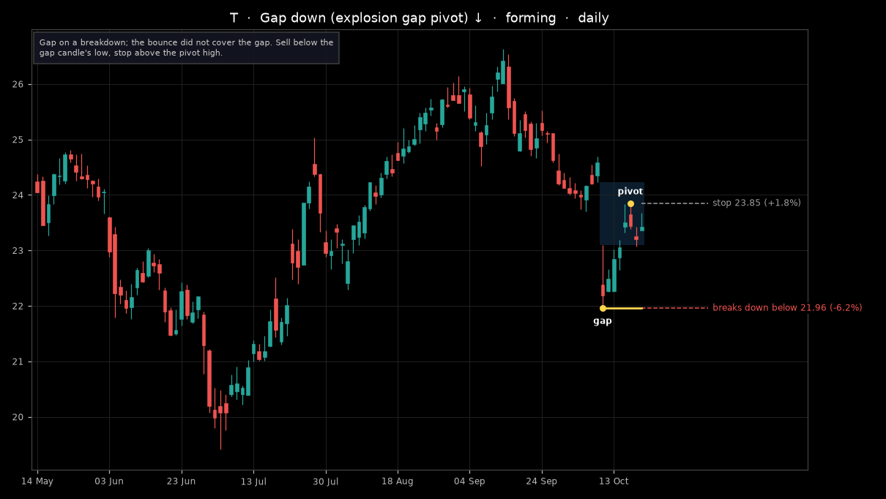

🟡 <b>T</b> — Gap down (explosion gap pivot) ↓ forming (daily)
Price now 23.42
↓ completes on a close below 21.96 (-6.2%)
📖 Gap on a breakdown; the bounce did not cover the gap. Sell below the gap candle&#x27;s low, stop above the pivot high.
<a href="https://www.tradingview.com/chart/?symbol=T">TradingView</a>

### 32-TMUS-Gap_down-forming.png

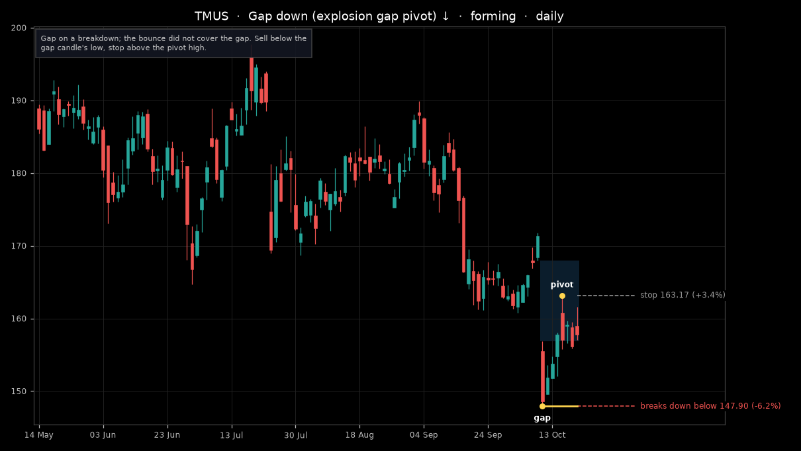

🟡 <b>TMUS</b> — Gap down (explosion gap pivot) ↓ forming (daily)
Price now 157.75
↓ completes on a close below 147.90 (-6.2%)
📖 Gap on a breakdown; the bounce did not cover the gap. Sell below the gap candle&#x27;s low, stop above the pivot high.
<a href="https://www.tradingview.com/chart/?symbol=TMUS">TradingView</a>

### 33-WMT-Bull_flag-forming.png

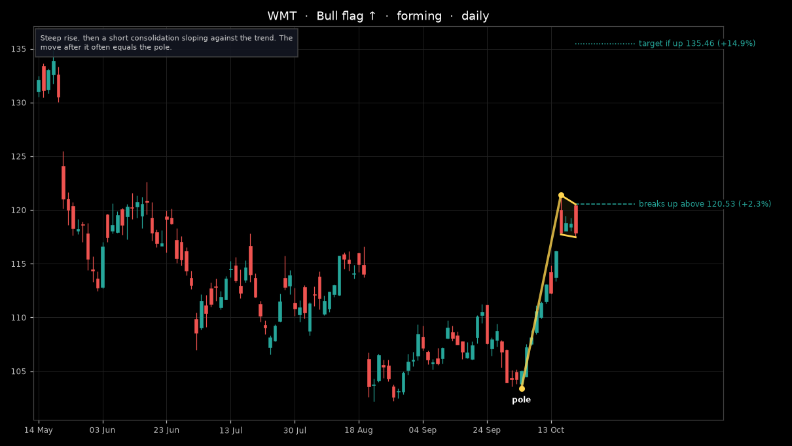

🟡 <b>WMT</b> — Bull flag ↑ forming (daily)
Price now 117.85
↑ completes on a close above 120.53 (+2.3%) → target 135.46
📖 Steep rise, then a short consolidation sloping against the trend. The move after it often equals the pole.
<a href="https://www.tradingview.com/chart/?symbol=WMT">TradingView</a>

### 34-WMT-Gap_up-forming.png

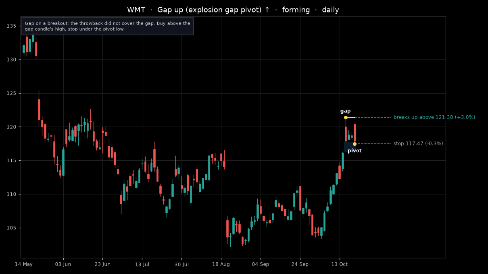

🟡 <b>WMT</b> — Gap up (explosion gap pivot) ↑ forming (daily)
Price now 117.85
↑ completes on a close above 121.38 (+3.0%)
📖 Gap on a breakout; the throwback did not cover the gap. Buy above the gap candle&#x27;s high, stop under the pivot low.
<a href="https://www.tradingview.com/chart/?symbol=WMT">TradingView</a>
