# Pattern scan preview 2026-10-21 (daily)

```
🧩 Pattern scan — S&P 100, daily candles, 21 Oct 09:03 NY
99 breakouts, 101 forming · 30 charts sent

New
🔴 AVGO Triple top ↓ @ 335.20 → 294.49
🟢 BA Descending triangle ↑ @ 186.74 → 207.42
🟢 CMCSA Symmetrical triangle ↑ @ 22.09 → 26.67
🔴 GOOGL Symmetrical triangle ↓ @ 342.67 → 273.14
🟢 LIN Cup and handle ↑ @ 492.88 → 530.79
🔴 LRCX Rectangle ↓ @ 275.45 → 196.02
🔴 META Double top ↓ @ 711.68 → 643.55
🟢 MMM Descending triangle ↑ @ 167.48 → 179.26
🔴 ORCL Descending triangle ↓ @ 130.79 → 108.86 ⚠️
🟢 PEP Rising wedge ↑ @ 132.90 → 142.58
🔴 TSLA Ascending triangle ↓ @ 359.11 → 267.93 ⚠️
🔴 UBER Ascending triangle ↓ @ 69.32 → 64.46
🟢 USB Descending triangle ↑ @ 57.06 → 61.62
🟢 WFC Descending triangle ↑ @ 83.21 → 97.20 ⚠️
🔴 ABBV Narrow range (NR4) ↓ @ 282.95
🔴 ABBV Inside bar ↓ @ 285.42
🔴 ABT Narrow range (NR4) ↓ @ 103.54
🟢 ACN Gap up (explosion gap pivot) ↑ @ 226.27
🔴 AMD Narrow range (NR4) ↓ @ 535.67
🔴 AMGN Narrow range (NR4) ↓ @ 431.39
🟢 AMT Gap up (explosion gap pivot) ↑ @ 182.52
🟢 BKNG Narrow range (NR4) ↑ @ 162.74
🔴 BKNG Inside bar ↓ @ 163.45
🟢 BLK Inside bar ↑ @ 1124.60
🟢 BMY Narrow range (NR4) ↑ @ 59.87
🟢 BNY Narrow range (NR4) ↑ @ 144.00
🔴 BNY Inside bar ↓ @ 142.44
🟢 BRK-B Narrow range (NR4) ↑ @ 533.19
🔴 BRK-B Inside bar ↓ @ 532.02
🔴 CAT Narrow range (NR4) ↓ @ 728.69
🔴 COST Inside bar ↓ @ 989.11
🟢 CVX Narrow range (NR4) ↑ @ 225.67
🔴 DE Bear flag ↓ @ 655.39 → 571.88
🔴 DHR Narrow range (NR4) ↓ @ 228.36
🔴 DHR Inside bar ↓ @ 229.04
🟢 DIS Narrow range (NR4) ↑ @ 110.11
🔴 DUK Inside bar ↓ @ 121.47
🔴 EMR Inside bar ↓ @ 160.54
🟢 FDX Narrow range (NR4) ↑ @ 295.29
🟢 FDX Inside bar ↑ @ 293.78
🟢 GD Inside bar ↑ @ 341.43
🔴 GE Narrow range (NR4) ↓ @ 310.64
🔴 GEV Narrow range (NR4) ↓ @ 916.00
🔴 GILD Narrow range (NR4) ↓ @ 155.62
🔴 GOOGL Narrow range (NR4) ↓ @ 341.85
🔴 GOOGL Inside bar ↓ @ 344.18
🟢 HD Narrow range (NR4) ↑ @ 311.58
🔴 INTC Narrow range (NR4) ↓ @ 91.88
🟢 INTU Narrow range (NR4) ↑ @ 327.19
🟢 ISRG Narrow range (NR4) ↑ @ 434.62
🟢 ISRG Inside bar ↑ @ 433.18
🔴 JNJ Narrow range (NR4) ↓ @ 254.00
🔴 JNJ Inside bar ↓ @ 255.56
🟢 LLY Gap up (explosion gap pivot) ↑ @ 1275.88
🟢 LLY Narrow range (NR4) ↑ @ 1259.75
🔴 LLY Inside bar ↓ @ 1257.03
🟢 LOW Narrow range (NR4) ↑ @ 195.48
🔴 LRCX Gap down (explosion gap pivot) ↓ @ 266.12
🔴 LRCX Narrow range (NR4) ↓ @ 271.87
🟢 MCD Narrow range (NR4) ↑ @ 243.61
🟢 MDLZ Narrow range (NR4) ↑ @ 63.98
🔴 MDLZ Inside bar ↓ @ 63.91
🔴 MO Narrow range (NR4) ↓ @ 74.50
🔴 MO Inside bar ↓ @ 75.11
🔴 MRK Narrow range (NR4) ↓ @ 145.61
🔴 MRK Inside bar ↓ @ 145.95
🟢 MSFT Inside bar ↑ @ 533.52
🔴 MU Narrow range (NR4) ↓ @ 900.57
🟢 MU Inside bar ↑ @ 878.84
🔴 NFLX Narrow range (NR4) ↓ @ 69.02
🟢 NOW Inside bar ↑ @ 145.36
🔴 ORCL Inside bar ↓ @ 129.59
🔴 PANW Inside bar ↓ @ 346.95
🔴 PEP Inside bar ↓ @ 131.49
🔴 PM Narrow range (NR4) ↓ @ 200.89
🔴 PM Inside bar ↓ @ 205.20
🟢 QCOM Inside bar ↑ @ 172.11
🟢 RTX Inside bar ↑ @ 192.11
🔴 SCHW Inside bar ↓ @ 91.96
🟢 SNDK Inside bar ↑ @ 1299.30
🟢 SO Inside bar ↑ @ 89.27
🟢 TMO Inside bar ↑ @ 690.00
🔴 TMUS Inside bar ↓ @ 159.10
🟢 TSLA Inside bar ↑ @ 368.06
🔴 UBER Narrow range (NR4) ↓ @ 69.77
🔴 UBER Inside bar ↓ @ 69.96
🟢 UNH Narrow range (NR4) ↑ @ 408.50
🟢 UNH Inside bar ↑ @ 406.88
🟢 UPS Narrow range (NR4) ↑ @ 97.69
🔴 UPS Inside bar ↓ @ 97.46
🔴 VZ Inside bar ↓ @ 44.79
🔴 WMT Narrow range (NR4) ↓ @ 118.05
🔴 WMT Inside bar ↓ @ 118.81
🔴 AMGN Shooting star ↓ @ 433.42
🟢 BNY Hammer ↑ @ 142.63
🟢 C Hammer ↑ @ 123.45
🔴 GE Shooting star ↓ @ 313.20
🔴 GILD Shooting star ↓ @ 156.02
🟢 V Doji ↑ @ 404.74
🟡 AAPL Triple top (↓325.81, now 339.50)
🟡 ADBE Rectangle (↑258.00 / ↓230.00, now 256.73)
🟡 AMGN Cup and handle (↑445.81, now 438.94)
🟡 AMZN Rectangle (↑265.38 / ↓249.15, now 262.63)
🟡 BKNG Rectangle (↑169.02 / ↓152.27, now 163.92)
🟡 BLK Double bottom (↑1181.11, now 1128.68)
🟡 BMY Inverse head &amp; shoulders (↑61.92, now 61.68)  (no chart: limit reached)


🟡 COF Rectangle (↑202.85 / ↓193.61, now 201.56)  (no chart: limit reached)
🟡 CRM Cup and handle (↑267.80, now 242.43)  (no chart: limit reached)
🟡 CSCO Triple bottom (↑124.23, now 106.71)  (no chart: limit reached)
🟡 DE Falling wedge (↑651.86 / ↓606.41, now 632.20)  (no chart: limit reached)
🟡 DHR Rectangle (↑233.39 / ↓212.57, now 224.24)  (no chart: limit reached)
🟡 DIS Cup and handle (↑112.69, now 111.67)  (no chart: limit reached)
🟡 EMR Cup and handle (↑165.79, now 160.46)  (no chart: limit reached)
🟡 GEV Head &amp; shoulders top (↓871.53, now 890.33)  (no chart: limit reached)
🟡 GEV Triple bottom (↑1195.94, now 890.33)  (no chart: limit reached)
🟡 GM Head &amp; shoulders top (↓76.93, now 77.09)  (no chart: limit reached)
🟡 GS Falling wedge (↑909.49 / ↓854.28, now 884.81)  (no chart: limit reached)
🟡 INTU Symmetrical triangle (↑341.61 / ↓263.58, now 335.29)  (no chart: limit reached)
🟡 JPM Rectangle (↑344.43 / ↓327.35, now 335.26)  (no chart: limit reached)
🟡 LLY Double bottom (↑1292.65, now 1283.66)  (no chart: limit reached)
🟡 MDLZ Double bottom (↑66.07, now 63.99)  (no chart: limit reached)
🟡 MDT Cup and handle (↑96.93, now 94.63)  (no chart: limit reached)
🟡 MO Head &amp; shoulders top (↓60.12, now 74.64)  (no chart: limit reached)
🟡 MS Falling wedge (↑184.06 / ↓175.18, now 180.40)  (no chart: limit reached)
🟡 MU Head &amp; shoulders top (↓539.33, now 896.07)  (no chart: limit reached)
🟡 NFLX Double top (↓66.54, now 68.69)  (no chart: limit reached)
🟡 NOW Cup and handle (↑154.20, now 149.54)  (no chart: limit reached)
🟡 TMO Triple top (↓635.32, now 687.37)  (no chart: limit reached)
🟡 WMT Cup and handle (↑122.65, now 117.85)  (no chart: limit reached)
🟡 AAPL Narrow range (NR4) (↑343.06 / ↓338.70, now 339.50)
🟡 ABBV Bull flag (↑291.41, now 289.08)  (no chart: limit reached)
🟡 ABT Bull flag (↑105.78, now 102.45)  (no chart: limit reached)
🟡 ACN Narrow range (NR4) (↑243.67 / ↓237.82, now 239.12)
🟡 AMAT Narrow range (NR4) (↑412.46 / ↓399.02, now 404.98)
🟡 AMD Bear pennant (↓524.60, now 534.74)  (no chart: limit reached)
🟡 AMGN Bull flag (↑439.05, now 438.94)  (no chart: limit reached)
🟡 AMT Narrow range (NR4) (↑185.86 / ↓182.96, now 183.56)
🟡 AMT Inside bar (↑183.56 / ↓183.56, now 183.56)
🟡 AMZN Narrow range (NR4) (↑265.34 / ↓260.42, now 262.63)
🟡 ANET Bear pennant (↓176.54, now 181.19)  (no chart: limit reached)
🟡 ANET Gap down (explosion gap pivot) (↓178.47, now 181.19)  (no chart: limit reached)
🟡 ANET Narrow range (NR4) (↑183.33 / ↓177.36, now 181.19)
🟡 BA Narrow range (NR4) (↑192.67 / ↓189.40, now 190.47)
🟡 BAC Bear flag (↓49.50, now 50.64)  (no chart: limit reached)
🟡 BAC Gap down (explosion gap pivot) (↓49.26, now 50.64)  (no chart: limit reached)
🟡 BKNG Bear flag (↓154.99, now 163.92)  (no chart: limit reached)
🟡 CAT Bear flag (↓705.20, now 725.24)  (no chart: limit reached)
🟡 CMCSA Bear flag (↓20.34, now 22.36)  (no chart: limit reached)
🟡 CMCSA Narrow range (NR4) (↑22.41 / ↓22.04, now 22.36)
🟡 COST Bull pennant (↑1004.81, now 994.61)  (no chart: limit reached)
🟡 COST Narrow range (NR4) (↑1003.00 / ↓991.00, now 994.61)
🟡 CSCO Narrow range (NR4) (↑107.06 / ↓105.30, now 106.71)
🟡 DELL Gap down (explosion gap pivot) (↓451.79, now 461.56)  (no chart: limit reached)
🟡 DIS Bull flag (↑112.34, now 111.67)  (no chart: limit reached)
🟡 DUK Bull flag (↑121.50, now 121.33)  (no chart: limit reached)
🟡 DUK Narrow range (NR4) (↑121.50 / ↓119.70, now 121.33)
🟡 EMR Bull flag (↑164.38, now 160.46)  (no chart: limit reached)
🟡 GEV Bear flag (↓873.19, now 890.33)  (no chart: limit reached)
🟡 GILD Bull flag (↑157.68, now 156.51)  (no chart: limit reached)
🟡 IBM Narrow range (NR4) (↑242.53 / ↓236.00, now 241.92)
🟡 INTC Bear flag (↓88.77, now 91.69)  (no chart: limit reached)
🟡 INTU Pipe top (↓320.86, now 335.29)  (no chart: limit reached)
🟡 KO Bull pennant (↑94.00, now 93.49)  (no chart: limit reached)


🟡 KO Inside bar (↑93.49 / ↓93.49, now 93.49)
🟡 MA Narrow range (NR4) (↑624.29 / ↓616.60, now 620.42)
🟡 MDLZ Bull pennant (↑64.46, now 63.99)  (no chart: limit reached)
🟡 MDT Bull flag (↑95.37, now 94.63)  (no chart: limit reached)
🟡 MDT Narrow range (NR4) (↑94.92 / ↓93.42, now 94.63)
🟡 MO Bull flag (↑75.52, now 74.64)  (no chart: limit reached)
🟡 MS Gap down (explosion gap pivot) (↓176.44, now 180.40)  (no chart: limit reached)
🟡 MSFT Bull flag (↑537.39, now 531.87)  (no chart: limit reached)
🟡 MU Bear pennant (↓881.52, now 896.07)  (no chart: limit reached)
🟡 NEE Narrow range (NR4) (↑79.30 / ↓78.35, now 78.86)
🟡 NEE Inside bar (↑78.86 / ↓78.86, now 78.86)
🟡 NOW Narrow range (NR4) (↑150.04 / ↓146.31, now 149.54)
🟡 NVDA Bear flag (↓212.77, now 216.47)  (no chart: limit reached)
🟡 PEP Narrow range (NR4) (↑134.95 / ↓133.40, now 134.02)
🟡 PG Bull pennant (↑159.47, now 159.32)  (no chart: limit reached)
🟡 PG Narrow range (NR4) (↑159.47 / ↓158.06, now 159.32)
🟡 PLTR Narrow range (NR4) (↑196.11 / ↓189.42, now 192.60)
🟡 PLTR Inside bar (↑192.60 / ↓192.60, now 192.60)
🟡 PM Bull pennant (↑203.03, now 199.90)  (no chart: limit reached)
🟡 QCOM Bear flag (↓168.75, now 175.71)  (no chart: limit reached)
🟡 SCHW Narrow range (NR4) (↑91.50 / ↓89.33, now 90.89)
🟡 SNDK Bear pennant (↓1330.00, now 1365.38)  (no chart: limit reached)
🟡 SO Bull flag (↑91.18, now 90.71)  (no chart: limit reached)
🟡 SO Narrow range (NR4) (↑91.03 / ↓89.70, now 90.71)
🟡 T Gap down (explosion gap pivot) (↓21.96, now 23.42)  (no chart: limit reached)
🟡 T Narrow range (NR4) (↑23.68 / ↓23.36, now 23.42)
🟡 TMO Narrow range (NR4) (↑693.37 / ↓679.32, now 687.37)
🟡 TMUS Gap down (explosion gap pivot) (↓147.90, now 157.75)  (no chart: limit reached)
🟡 UNP Bull flag (↑291.08, now 287.61)  (no chart: limit reached)
🟡 WFC Narrow range (NR4) (↑82.53 / ↓81.15, now 82.20)
🟡 WMT Bull flag (↑120.53, now 117.85)  (no chart: limit reached)
🟡 WMT Gap up (explosion gap pivot) (↑121.38, now 117.85)  (no chart: limit reached)
🟡 AMAT Doji (↑412.46 / ↓399.02, now 404.98)
🟡 COP Hanging man (↑147.15 / ↓142.80, now 145.95)
🟡 GM Doji (↑78.97 / ↓75.08, now 77.09)
🟡 NVDA Doji (↑218.46 / ↓212.77, now 216.47)
🟡 RTX Doji (↑197.00 / ↓188.08, now 193.34)

✅ scan done in 10s
```

### 01-AVGO-Triple_top-breakout.png

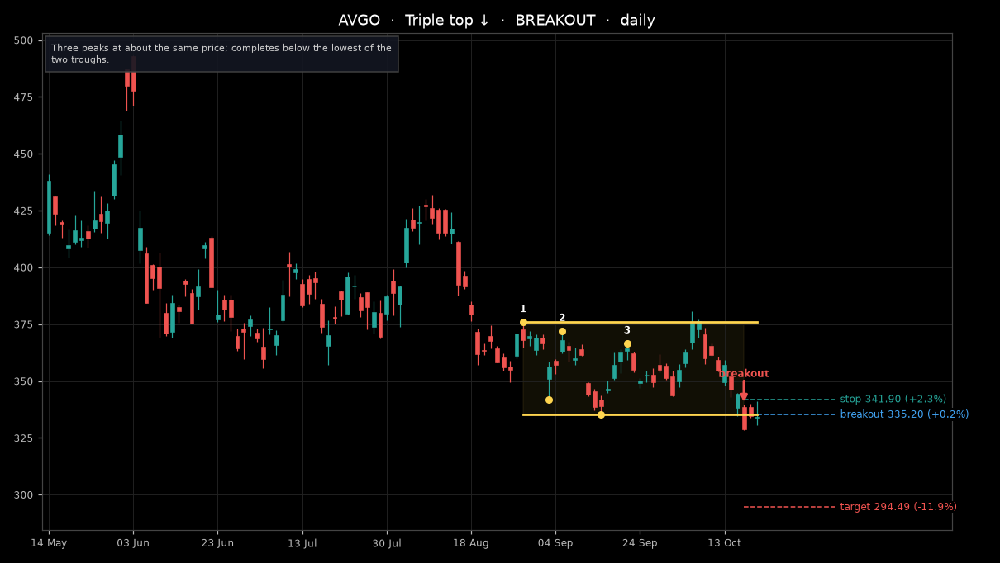

🔴 <b>AVGO</b> — Triple top ↓ <b>BREAKOUT</b> (daily)
Close 334.37 on 20 Oct; broke below 335.20 on 16 Oct
🎯 target 294.49 (-11.9%) · 🛑 stop 341.90 (+2.3%) · R:R 5.3
📖 Three peaks at about the same price; completes below the lowest of the two troughs.
<a href="https://www.tradingview.com/chart/?symbol=AVGO">TradingView</a>

### 02-BA-Descending_triangle-breakout.png

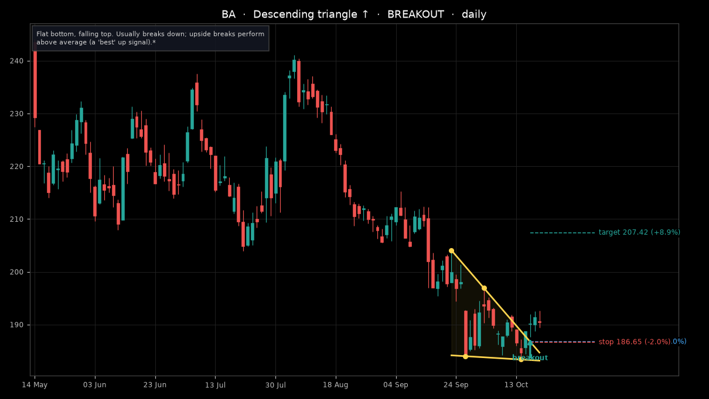

🟢 <b>BA</b> — Descending triangle ↑ <b>BREAKOUT</b> (daily)
Close 190.47 on 20 Oct; broke above 186.74 on 16 Oct
🎯 target 207.42 (+8.9%) · 🛑 stop 186.65 (-2.0%) · R:R 4.4
📖 Flat bottom, falling top. Usually breaks down; upside breaks perform above average (a &#x27;best&#x27; up signal).*
<a href="https://www.tradingview.com/chart/?symbol=BA">TradingView</a>

### 03-CMCSA-Symmetrical_triangle-breakout.png

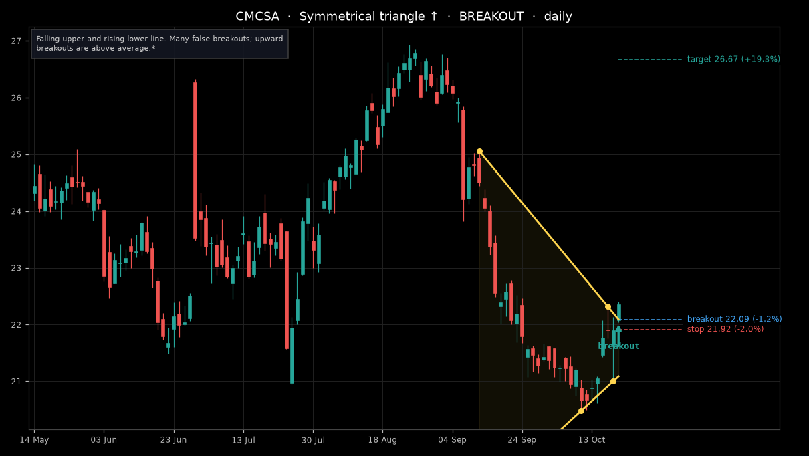

🟢 <b>CMCSA</b> — Symmetrical triangle ↑ <b>BREAKOUT</b> (daily)
Close 22.36 on 20 Oct; broke above 22.09 on 20 Oct
🎯 target 26.67 (+19.3%) · 🛑 stop 21.92 (-2.0%) · R:R 9.7
📖 Falling upper and rising lower line. Many false breakouts; upward breakouts are above average.*
<a href="https://www.tradingview.com/chart/?symbol=CMCSA">TradingView</a>

### 04-GOOGL-Symmetrical_triangle-breakout.png

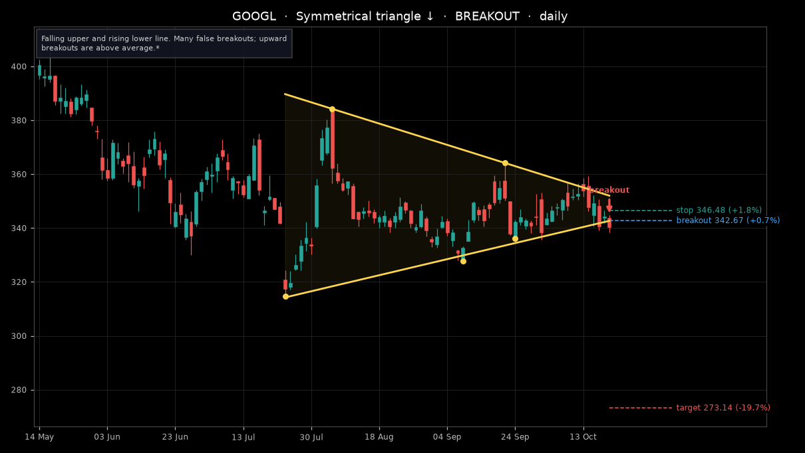

🔴 <b>GOOGL</b> — Symmetrical triangle ↓ <b>BREAKOUT</b> (daily)
Close 340.27 on 20 Oct; broke below 342.67 on 20 Oct
🎯 target 273.14 (-19.7%) · 🛑 stop 346.48 (+1.8%) · R:R 10.8
📖 Falling upper and rising lower line. Many false breakouts; upward breakouts are above average.*
<a href="https://www.tradingview.com/chart/?symbol=GOOGL">TradingView</a>

### 05-LIN-Cup_and_handle-breakout.png

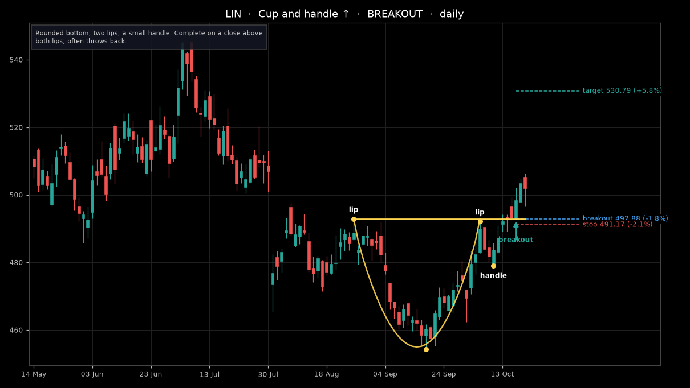

🟢 <b>LIN</b> — Cup and handle ↑ <b>BREAKOUT</b> (daily)
Close 501.89 on 20 Oct; broke above 492.88 on 16 Oct
🎯 target 530.79 (+5.8%) · 🛑 stop 491.17 (-2.1%) · R:R 2.7
📖 Rounded bottom, two lips, a small handle. Complete on a close above both lips; often throws back.
<a href="https://www.tradingview.com/chart/?symbol=LIN">TradingView</a>

### 06-LRCX-Rectangle-breakout.png

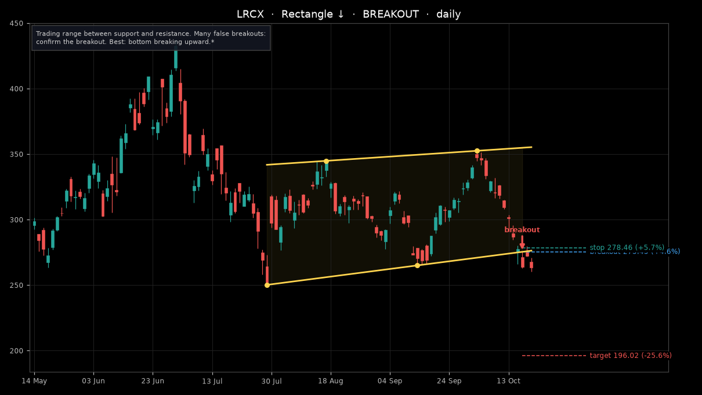

🔴 <b>LRCX</b> — Rectangle ↓ <b>BREAKOUT</b> (daily)
Close 263.45 on 20 Oct; broke below 275.45 on 16 Oct
🎯 target 196.02 (-25.6%) · 🛑 stop 278.46 (+5.7%) · R:R 4.5
📖 Trading range between support and resistance. Many false breakouts: confirm the breakout. Best: bottom breaking upward.*
<a href="https://www.tradingview.com/chart/?symbol=LRCX">TradingView</a>

### 07-META-Double_top-breakout.png

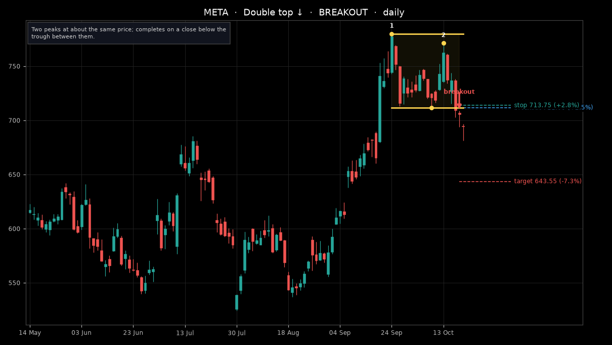

🔴 <b>META</b> — Double top ↓ <b>BREAKOUT</b> (daily)
Close 694.25 on 20 Oct; broke below 711.68 on 19 Oct
🎯 target 643.55 (-7.3%) · 🛑 stop 713.75 (+2.8%) · R:R 2.6
📖 Two peaks at about the same price; completes on a close below the trough between them.
<a href="https://www.tradingview.com/chart/?symbol=META">TradingView</a>

### 08-MMM-Descending_triangle-breakout.png

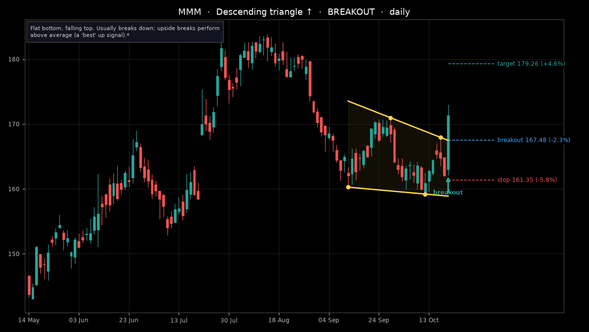

🟢 <b>MMM</b> — Descending triangle ↑ <b>BREAKOUT</b> (daily)
Close 171.37 on 20 Oct; broke above 167.48 on 20 Oct
🎯 target 179.26 (+4.6%) · 🛑 stop 161.35 (-5.8%) · R:R 0.8
📖 Flat bottom, falling top. Usually breaks down; upside breaks perform above average (a &#x27;best&#x27; up signal).*
<a href="https://www.tradingview.com/chart/?symbol=MMM">TradingView</a>

### 09-ORCL-Descending_triangle-breakout.png

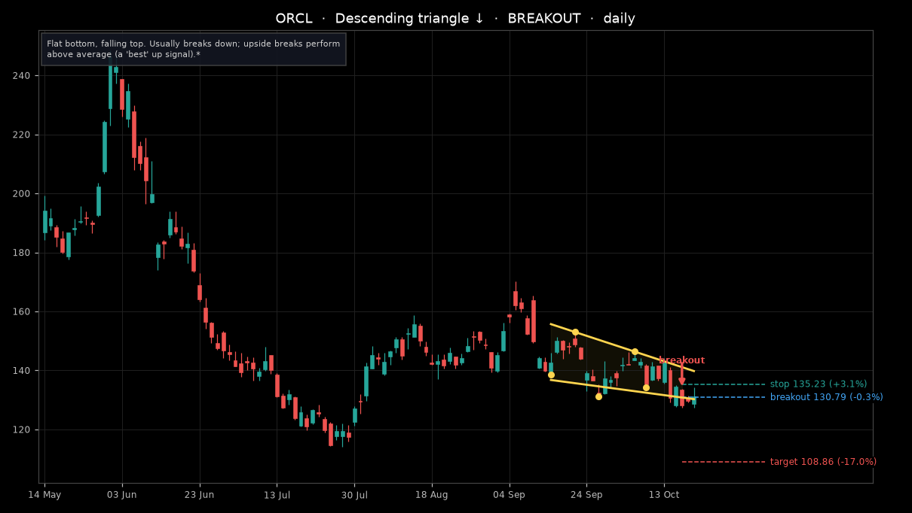

🔴 <b>ORCL</b> — Descending triangle ↓ <b>BREAKOUT</b> (daily)
Close 131.14 on 20 Oct; broke below 130.79 on 16 Oct
🎯 target 108.86 (-17.0%) · 🛑 stop 135.23 (+3.1%) · R:R 5.4
⚠️ Price is back through the breakout line: possible false breakout
📖 Flat bottom, falling top. Usually breaks down; upside breaks perform above average (a &#x27;best&#x27; up signal).*
<a href="https://www.tradingview.com/chart/?symbol=ORCL">TradingView</a>

### 10-PEP-Rising_wedge-breakout.png

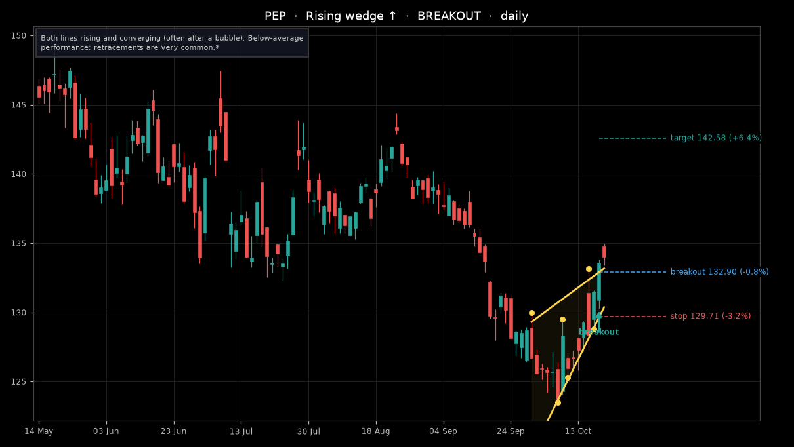

🟢 <b>PEP</b> — Rising wedge ↑ <b>BREAKOUT</b> (daily)
Close 134.02 on 20 Oct; broke above 132.90 on 19 Oct
🎯 target 142.58 (+6.4%) · 🛑 stop 129.71 (-3.2%) · R:R 2.0
📖 Both lines rising and converging (often after a bubble). Below-average performance; retracements are very common.*
<a href="https://www.tradingview.com/chart/?symbol=PEP">TradingView</a>

### 11-TSLA-Ascending_triangle-breakout.png

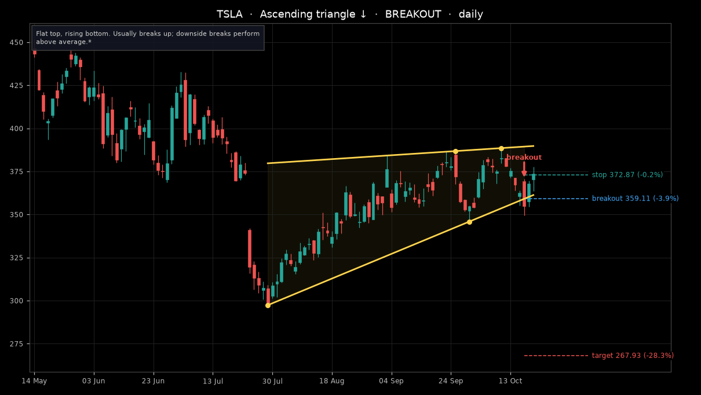

🔴 <b>TSLA</b> — Ascending triangle ↓ <b>BREAKOUT</b> (daily)
Close 373.71 on 20 Oct; broke below 359.11 on 16 Oct
🎯 target 267.93 (-28.3%) · 🛑 stop 372.87 (-0.2%) · R:R 125.9
⚠️ Price is back through the breakout line: possible false breakout
📖 Flat top, rising bottom. Usually breaks up; downside breaks perform above average.*
<a href="https://www.tradingview.com/chart/?symbol=TSLA">TradingView</a>

### 12-UBER-Ascending_triangle-breakout.png

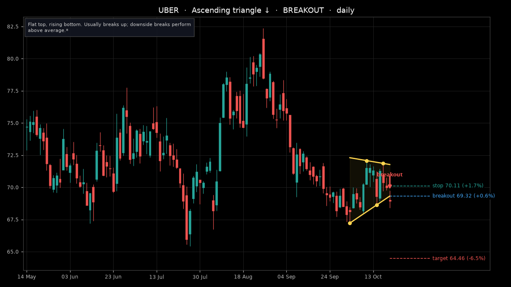

🔴 <b>UBER</b> — Ascending triangle ↓ <b>BREAKOUT</b> (daily)
Close 68.94 on 20 Oct; broke below 69.32 on 20 Oct
🎯 target 64.46 (-6.5%) · 🛑 stop 70.11 (+1.7%) · R:R 3.8
📖 Flat top, rising bottom. Usually breaks up; downside breaks perform above average.*
<a href="https://www.tradingview.com/chart/?symbol=UBER">TradingView</a>

### 13-USB-Descending_triangle-breakout.png

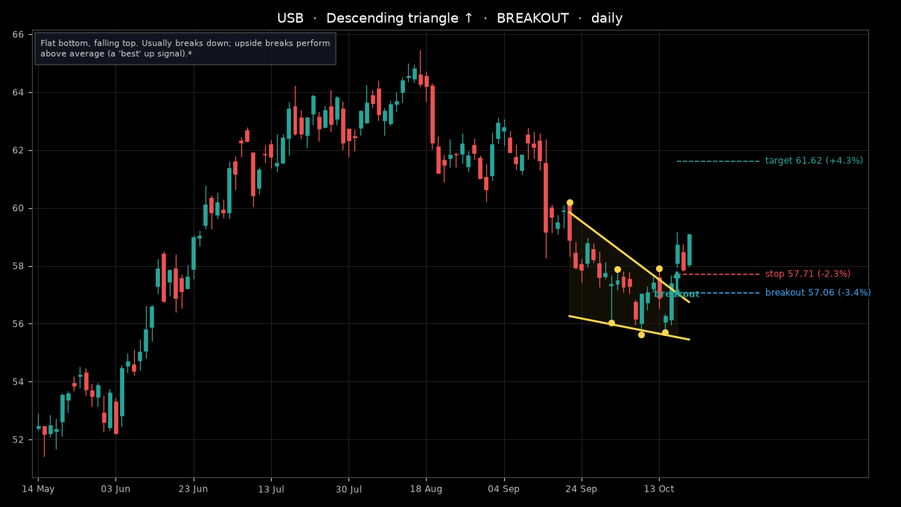

🟢 <b>USB</b> — Descending triangle ↑ <b>BREAKOUT</b> (daily)
Close 59.09 on 20 Oct; broke above 57.06 on 16 Oct
🎯 target 61.62 (+4.3%) · 🛑 stop 57.71 (-2.3%) · R:R 1.8
📖 Flat bottom, falling top. Usually breaks down; upside breaks perform above average (a &#x27;best&#x27; up signal).*
<a href="https://www.tradingview.com/chart/?symbol=USB">TradingView</a>

### 14-WFC-Descending_triangle-breakout.png

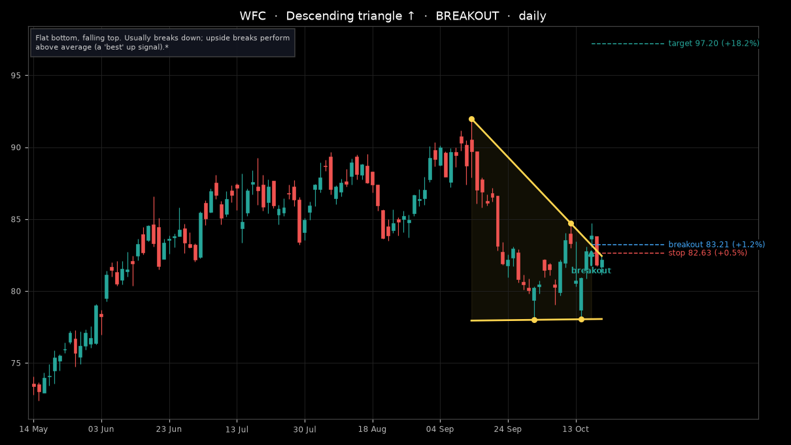

🟢 <b>WFC</b> — Descending triangle ↑ <b>BREAKOUT</b> (daily)
Close 82.20 on 20 Oct; broke above 83.21 on 16 Oct
🎯 target 97.20 (+18.2%) · 🛑 stop 82.63 (+0.5%) · R:R 35.0
⚠️ Price is back through the breakout line: possible false breakout
📖 Flat bottom, falling top. Usually breaks down; upside breaks perform above average (a &#x27;best&#x27; up signal).*
<a href="https://www.tradingview.com/chart/?symbol=WFC">TradingView</a>

### 15-ACN-Gap_up-breakout.png

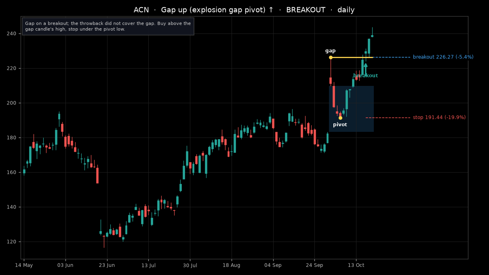

🟢 <b>ACN</b> — Gap up (explosion gap pivot) ↑ <b>BREAKOUT</b> (daily)
Close 239.12 on 20 Oct; broke above 226.27 on 16 Oct
🛑 stop 191.44 (-19.9%)
📖 Gap on a breakout; the throwback did not cover the gap. Buy above the gap candle&#x27;s high, stop under the pivot low.
<a href="https://www.tradingview.com/chart/?symbol=ACN">TradingView</a>

### 16-AMT-Gap_up-breakout.png

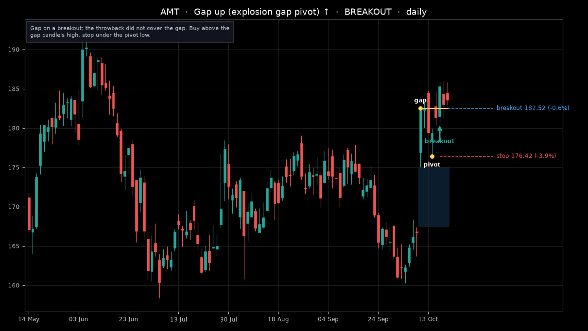

🟢 <b>AMT</b> — Gap up (explosion gap pivot) ↑ <b>BREAKOUT</b> (daily)
Close 183.56 on 20 Oct; broke above 182.52 on 16 Oct
🛑 stop 176.42 (-3.9%)
📖 Gap on a breakout; the throwback did not cover the gap. Buy above the gap candle&#x27;s high, stop under the pivot low.
<a href="https://www.tradingview.com/chart/?symbol=AMT">TradingView</a>

### 17-DE-Bear_flag-breakout.png

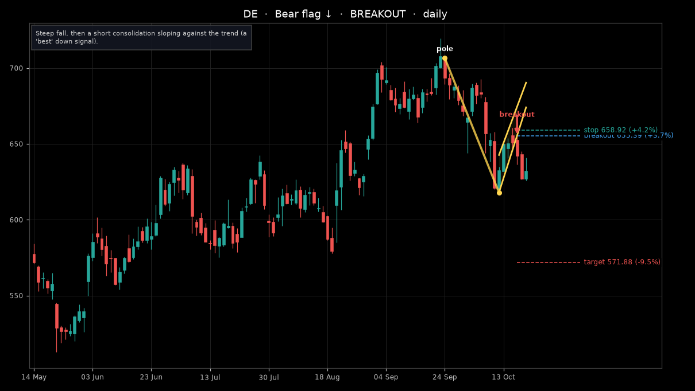

🔴 <b>DE</b> — Bear flag ↓ <b>BREAKOUT</b> (daily)
Close 632.20 on 20 Oct; broke below 655.39 on 16 Oct
🎯 target 571.88 (-9.5%) · 🛑 stop 658.92 (+4.2%) · R:R 2.3
📖 Steep fall, then a short consolidation sloping against the trend (a &#x27;best&#x27; down signal).
<a href="https://www.tradingview.com/chart/?symbol=DE">TradingView</a>

### 18-LLY-Gap_up-breakout.png

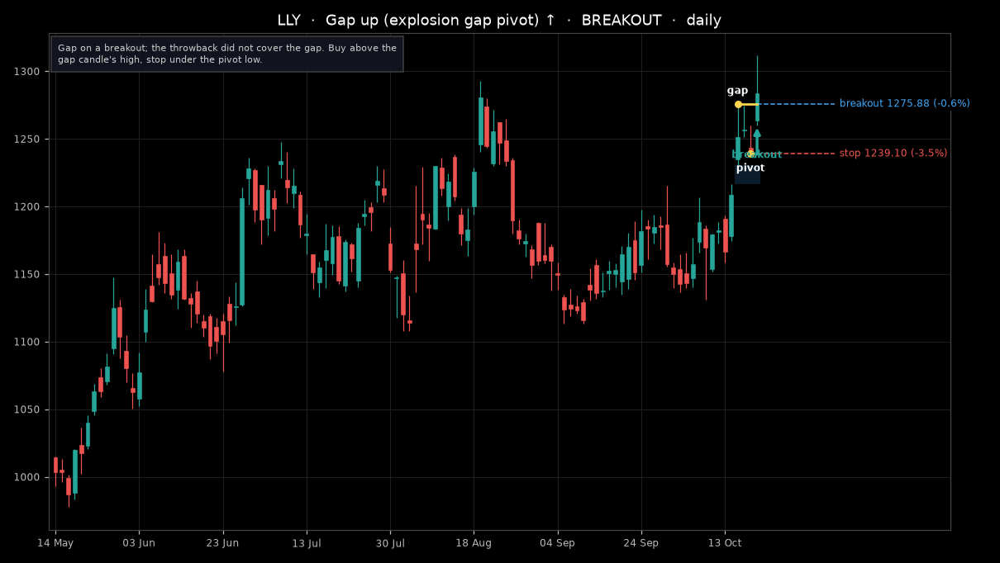

🟢 <b>LLY</b> — Gap up (explosion gap pivot) ↑ <b>BREAKOUT</b> (daily)
Close 1283.66 on 20 Oct; broke above 1275.88 on 20 Oct
🛑 stop 1239.10 (-3.5%)
📖 Gap on a breakout; the throwback did not cover the gap. Buy above the gap candle&#x27;s high, stop under the pivot low.
<a href="https://www.tradingview.com/chart/?symbol=LLY">TradingView</a>

### 19-LRCX-Gap_down-breakout.png

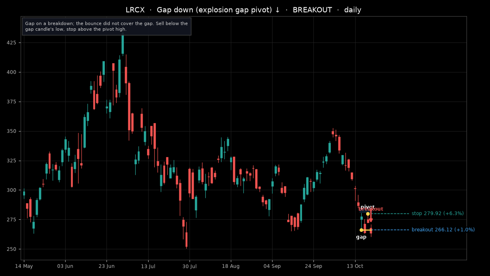

🔴 <b>LRCX</b> — Gap down (explosion gap pivot) ↓ <b>BREAKOUT</b> (daily)
Close 263.45 on 20 Oct; broke below 266.12 on 20 Oct
🛑 stop 279.92 (+6.3%)
📖 Gap on a breakdown; the bounce did not cover the gap. Sell below the gap candle&#x27;s low, stop above the pivot high.
<a href="https://www.tradingview.com/chart/?symbol=LRCX">TradingView</a>

### 20-AMGN-Shooting_star-breakout.png

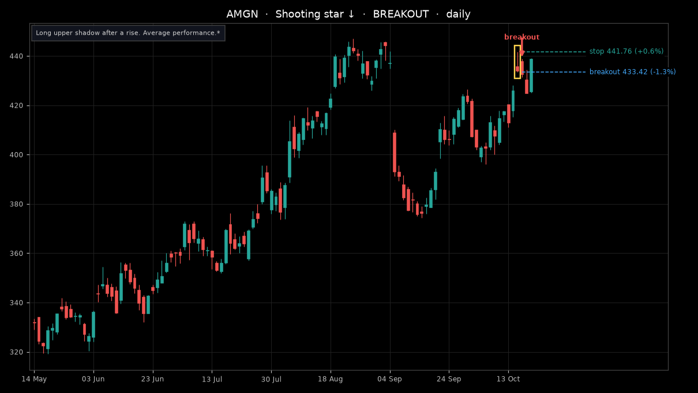

🔴 <b>AMGN</b> — Shooting star ↓ <b>BREAKOUT</b> (daily)
Close 438.94 on 20 Oct; broke below 433.42 on 16 Oct
🛑 stop 441.76 (+0.6%)
📖 Long upper shadow after a rise. Average performance.*
<a href="https://www.tradingview.com/chart/?symbol=AMGN">TradingView</a>

### 21-BNY-Hammer-breakout.png

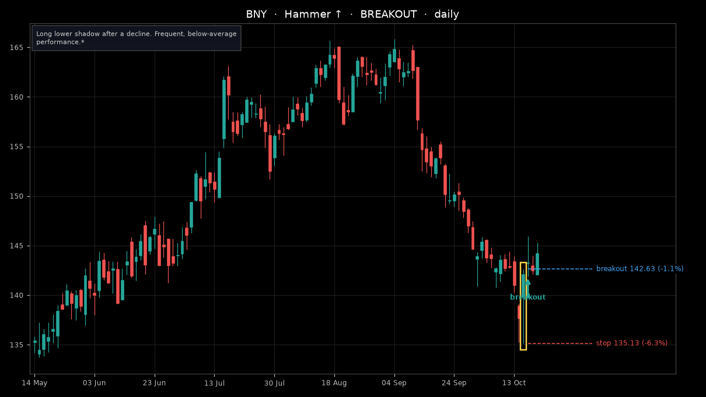

🟢 <b>BNY</b> — Hammer ↑ <b>BREAKOUT</b> (daily)
Close 144.25 on 20 Oct; broke above 142.63 on 16 Oct
🛑 stop 135.13 (-6.3%)
📖 Long lower shadow after a decline. Frequent, below-average performance.*
<a href="https://www.tradingview.com/chart/?symbol=BNY">TradingView</a>

### 22-C-Hammer-breakout.png

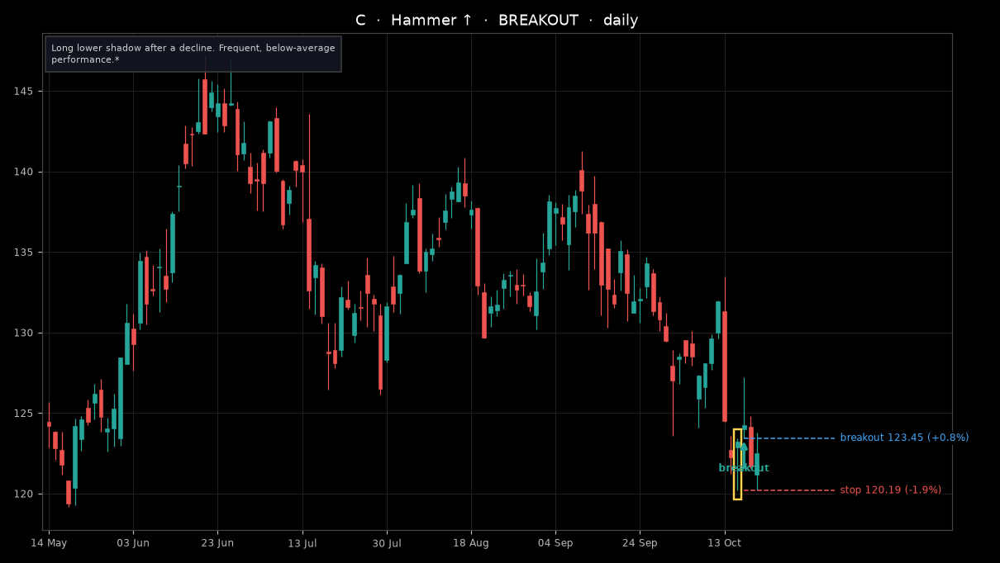

🟢 <b>C</b> — Hammer ↑ <b>BREAKOUT</b> (daily)
Close 122.51 on 20 Oct; broke above 123.45 on 16 Oct
🛑 stop 120.19 (-1.9%)
📖 Long lower shadow after a decline. Frequent, below-average performance.*
<a href="https://www.tradingview.com/chart/?symbol=C">TradingView</a>

### 23-GE-Shooting_star-breakout.png

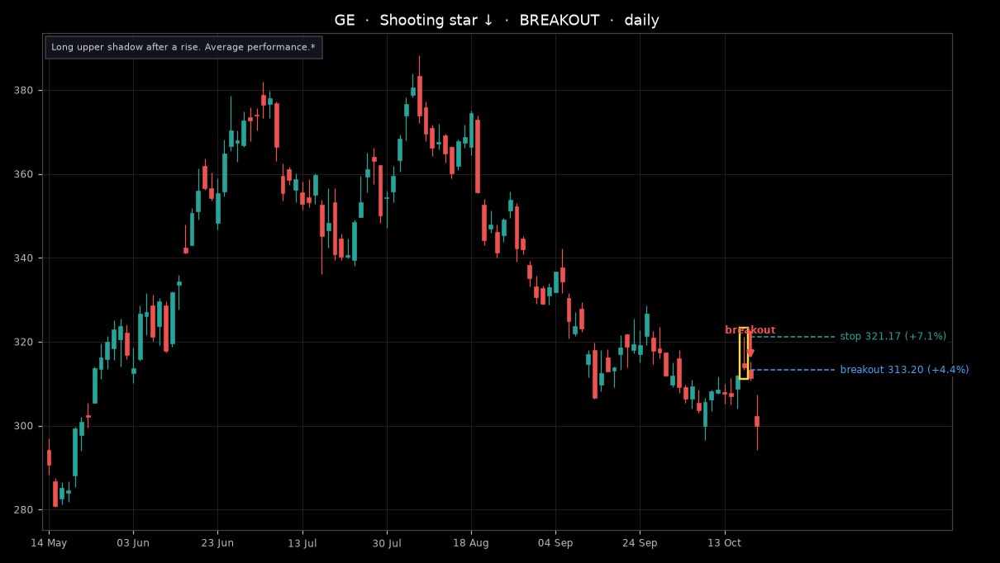

🔴 <b>GE</b> — Shooting star ↓ <b>BREAKOUT</b> (daily)
Close 299.87 on 20 Oct; broke below 313.20 on 19 Oct
🛑 stop 321.17 (+7.1%)
📖 Long upper shadow after a rise. Average performance.*
<a href="https://www.tradingview.com/chart/?symbol=GE">TradingView</a>

### 24-GILD-Shooting_star-breakout.png

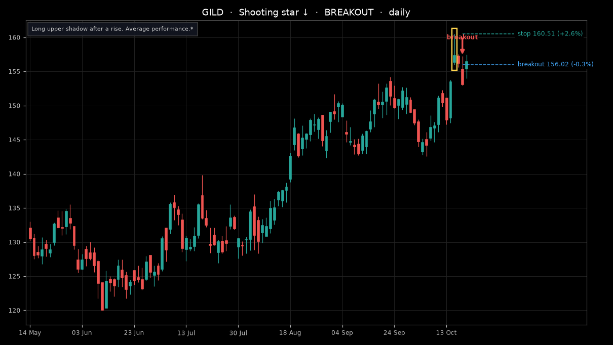

🔴 <b>GILD</b> — Shooting star ↓ <b>BREAKOUT</b> (daily)
Close 156.51 on 20 Oct; broke below 156.02 on 19 Oct
🛑 stop 160.51 (+2.6%)
📖 Long upper shadow after a rise. Average performance.*
<a href="https://www.tradingview.com/chart/?symbol=GILD">TradingView</a>

### 25-AAPL-Triple_top-forming.png

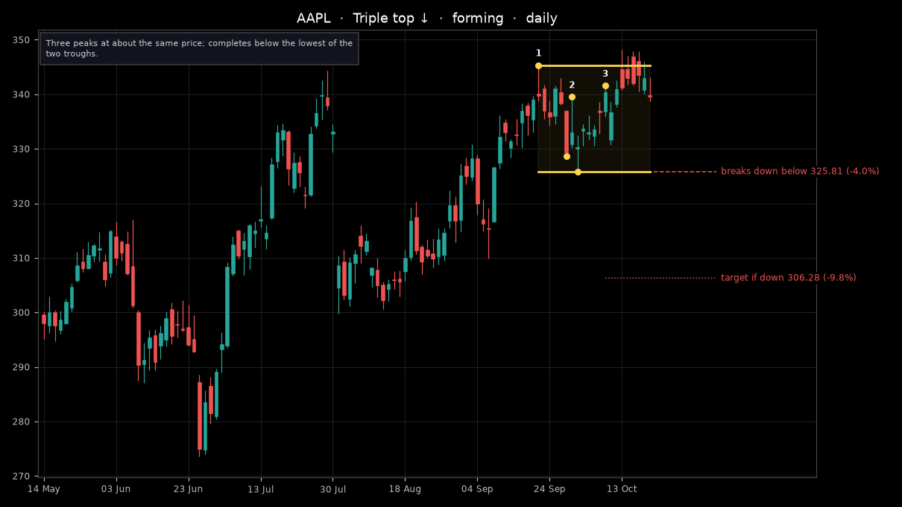

🟡 <b>AAPL</b> — Triple top ↓ forming (daily)
Price now 339.50
↓ completes on a close below 325.81 (-4.0%) → target 306.28
📖 Three peaks at about the same price; completes below the lowest of the two troughs.
<a href="https://www.tradingview.com/chart/?symbol=AAPL">TradingView</a>

### 26-ADBE-Rectangle-forming.png

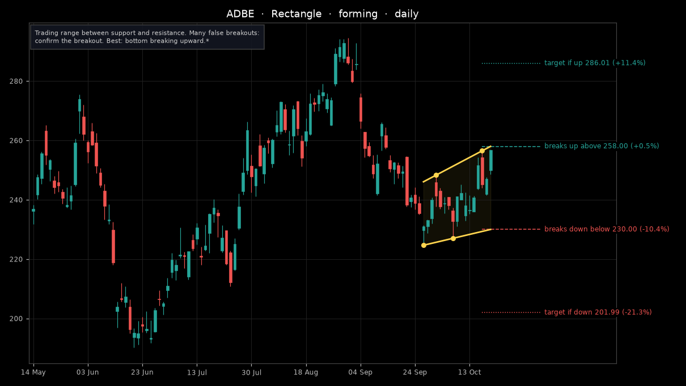

🟡 <b>ADBE</b> — Rectangle forming (daily)
Price now 256.73
↑ completes on a close above 258.00 (+0.5%) → target 286.01
↓ completes on a close below 230.00 (-10.4%) → target 201.99
📖 Trading range between support and resistance. Many false breakouts: confirm the breakout. Best: bottom breaking upward.*
<a href="https://www.tradingview.com/chart/?symbol=ADBE">TradingView</a>

### 27-AMGN-Cup_and_handle-forming.png

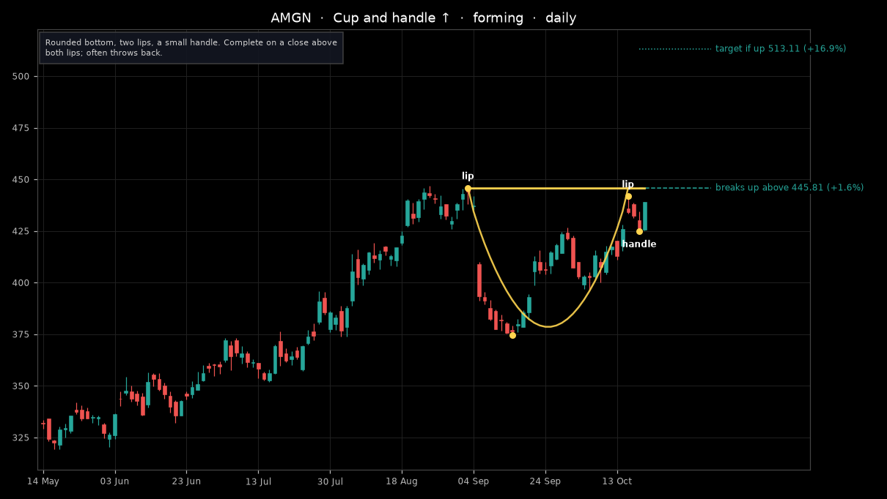

🟡 <b>AMGN</b> — Cup and handle ↑ forming (daily)
Price now 438.94
↑ completes on a close above 445.81 (+1.6%) → target 513.11
📖 Rounded bottom, two lips, a small handle. Complete on a close above both lips; often throws back.
<a href="https://www.tradingview.com/chart/?symbol=AMGN">TradingView</a>

### 28-AMZN-Rectangle-forming.png

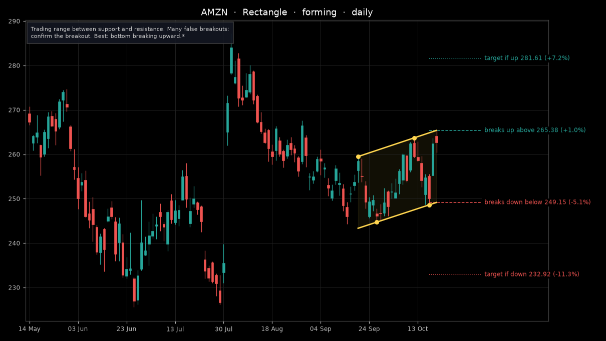

🟡 <b>AMZN</b> — Rectangle forming (daily)
Price now 262.63
↑ completes on a close above 265.38 (+1.0%) → target 281.61
↓ completes on a close below 249.15 (-5.1%) → target 232.92
📖 Trading range between support and resistance. Many false breakouts: confirm the breakout. Best: bottom breaking upward.*
<a href="https://www.tradingview.com/chart/?symbol=AMZN">TradingView</a>

### 29-BKNG-Rectangle-forming.png

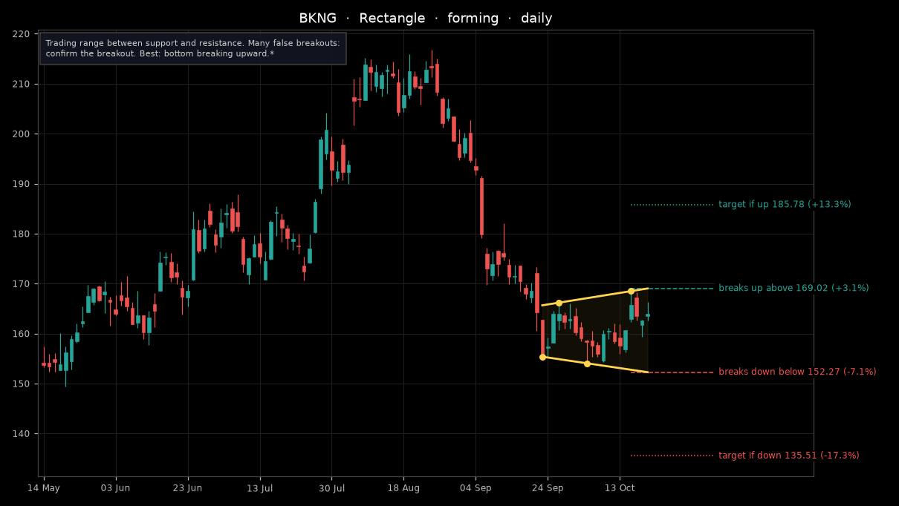

🟡 <b>BKNG</b> — Rectangle forming (daily)
Price now 163.92
↑ completes on a close above 169.02 (+3.1%) → target 185.78
↓ completes on a close below 152.27 (-7.1%) → target 135.51
📖 Trading range between support and resistance. Many false breakouts: confirm the breakout. Best: bottom breaking upward.*
<a href="https://www.tradingview.com/chart/?symbol=BKNG">TradingView</a>

### 30-BLK-Double_bottom-forming.png


🟡 <b>BLK</b> — Double bottom ↑ forming (daily)
Price now 1128.68
↑ completes on a close above 1181.11 (+4.6%) → target 1344.76
📖 Two troughs at about the same price; completes on a close above the peak between them.
<a href="https://www.tradingview.com/chart/?symbol=BLK">TradingView</a>
